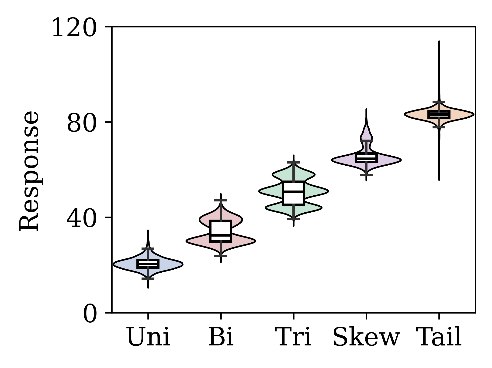

# csvGUI

[简体中文](README.md) | **English**

A lightweight desktop plotting toolkit for research. Plot raw CSV data, adjust styles, save editable projects, and export figures for journal layouts.

| Tool | Purpose | Documentation and gallery | Editable projects |
| --- | --- | --- | --- |
| **csvPLOT** | Multiple curves, moving averages, and detailed views | [Full guide, compact gallery, and hand-tuned example](csvPLOT/README.en.md) | [4 .cplot files](csvPLOT/examples/projects/) |
| **csvFIG** | Monochrome boxplots, mean/median connections, and distribution plots | [Full guide and 5 examples](csvFIG/README.en.md) | [5 .cfig files](csvFIG/examples/projects/) |

## Compact journal figures

| csvPLOT: curves and smoothing | csvFIG: violin and boxplot |
| --- | --- |
|  |  |
| [PNG](csvPLOT/examples/exports/curves.png) · [PDF](csvPLOT/examples/exports/curves.pdf) · [SVG](csvPLOT/examples/exports/curves.svg) · [Project](csvPLOT/examples/projects/curves.cplot) | [PNG](csvFIG/examples/exports/violin-box.png) · [PDF](csvFIG/examples/exports/violin-box.pdf) · [SVG](csvFIG/examples/exports/violin-box.svg) · [Project](csvFIG/examples/projects/violin-box.cfig) |

The examples use **axes approximately 2.6–2.8 inches wide with 13 pt text**, suitable for multi-panel layouts. PNG files are **600 DPI**; PDF and SVG preserve vectors. Titles are left to the manuscript caption. Figure margins automatically accommodate text, and csvFIG hides the legend by default. Each tool's README provides exact dimensions, plotting conventions, downloads, and screenshots of the controls.

Example projects are ready to edit: launch the corresponding tool and click **Open Project** to restore the data and styles. Gallery images were exported after reopening their projects. All example data are synthetic demonstrations, not real experimental results.

## Install and launch

Requires **Python 3.10+**, Tkinter, and a desktop display environment.

```powershell
git clone https://github.com/lbsun1999/csvGUI.git
cd csvGUI
python -m venv .venv
.venv\Scripts\Activate.ps1
python -m pip install -r requirements.txt
python csvPLOT/csvPLOT.py
# Or:
python csvFIG/csvFIG.py
```

`requirementLists.txt` is an alternative dependency entry point. On macOS/Linux, use `python3` and `source .venv/bin/activate` where appropriate. Linux needs the system Tkinter package. Run `python -m tkinter` to check desktop support.

Each tool has its own README, dependency entry points, CSV examples, exports, and project directory. Both use the canvas and font support in `common/`. Scripts can also be launched from their tool directories; preserve the repository structure.

## Data, appearance, and export

- csvPLOT: 5000 rows × 6 columns in the [experimental CSV](csvPLOT/examples/experiment_curves.csv). The first column is a row index; the remaining columns combine trends, harmonics, and noise. The default smoothing window is **25** points.
- csvFIG: 5000 rows × 5 columns of raw observations in the [experimental CSV](csvFIG/examples/experiment_distributions.csv), representing single-peak, bimodal, trimodal, right-skewed, and heavy-tailed populations.
- Both tools support axis limits, ticks, labels, figure layout, fonts, legends, colors, transparency, and multiple export formats. Width and height specify the **axes area**, while outer margins grow to fit the text.
- Font downloads and information: [Zhoushijiehqu/Academic-Font-TimesSimSun](https://github.com/Zhoushijiehqu/Academic-Font-TimesSimSun). Local loading instructions: [common/fonts](common/fonts/README.md). Font binaries are not included in this public repository.

## Reproduce the gallery

```powershell
# Rebuild synthetic CSVs and numeric metadata.
python examples/generate_examples.py
# Plot, save, reopen, and export 8 projects and 24 images through the GUI code.
python examples/render_gallery.py
# Check numeric and GUI workflows.
python -m unittest discover -s tests -v
```

Gallery export requires a desktop environment. Dimensions and export settings are recorded in the [gallery manifest](examples/gallery_manifest.json); data parameters are in the [dataset metadata](examples/dataset_metadata.json). The tool READMEs explain the data models. The additional hand-tuned csvPLOT example is maintained separately from the eight generated projects.

## Repository structure and future tools

```text
csvPLOT/                    Curve tool, detailed README, dependency entry points
  examples/                 CSVs, exports/, and editable projects/
csvFIG/                     Distribution tool, detailed README, dependency entry points
  examples/                 CSVs, exports/, and editable projects/
common/                     Shared UI support and optional local fonts
docs/screenshots/           Actual application windows and controls
examples/                   Data/gallery generators and metadata
tests/                      Numeric and GUI workflow checks
requirements.txt            Shared dependencies
requirementLists.txt         Alternative dependency entry point
LICENSE                     MIT license
```

Future tools will follow the same directory structure. Clustered boxplots are planned but are not currently supported. The series retains plotting, smoothing, styling, and project persistence; advanced data transformations are excluded.

Code is released under the [MIT license](LICENSE).
