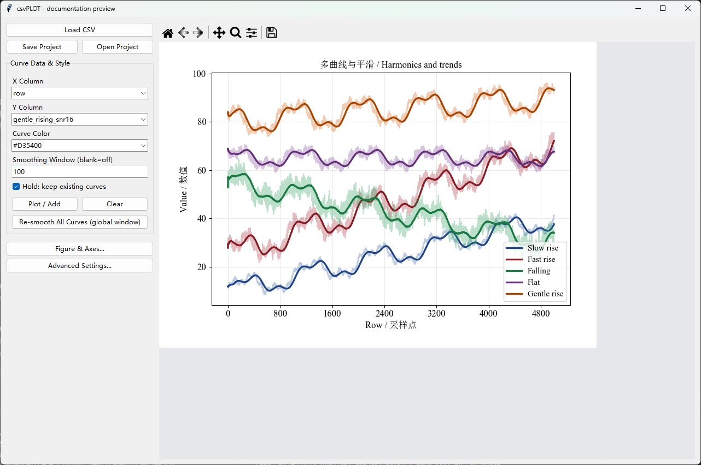
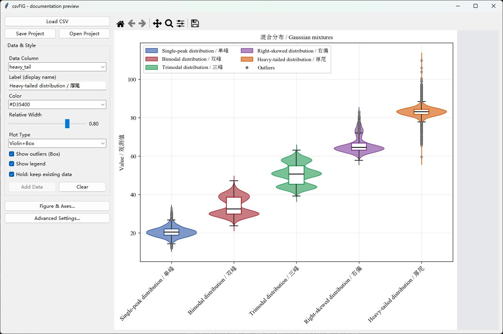
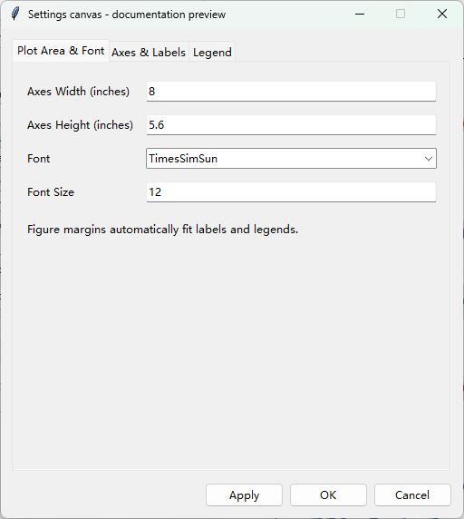
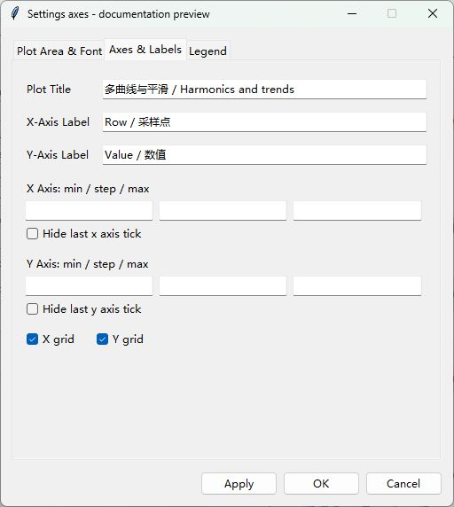
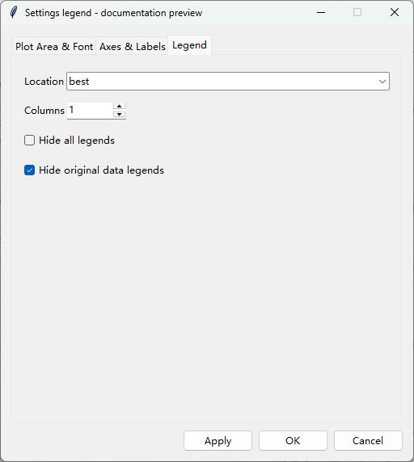
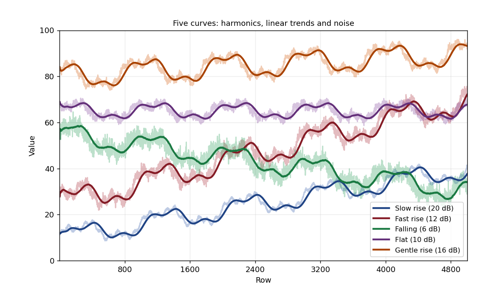
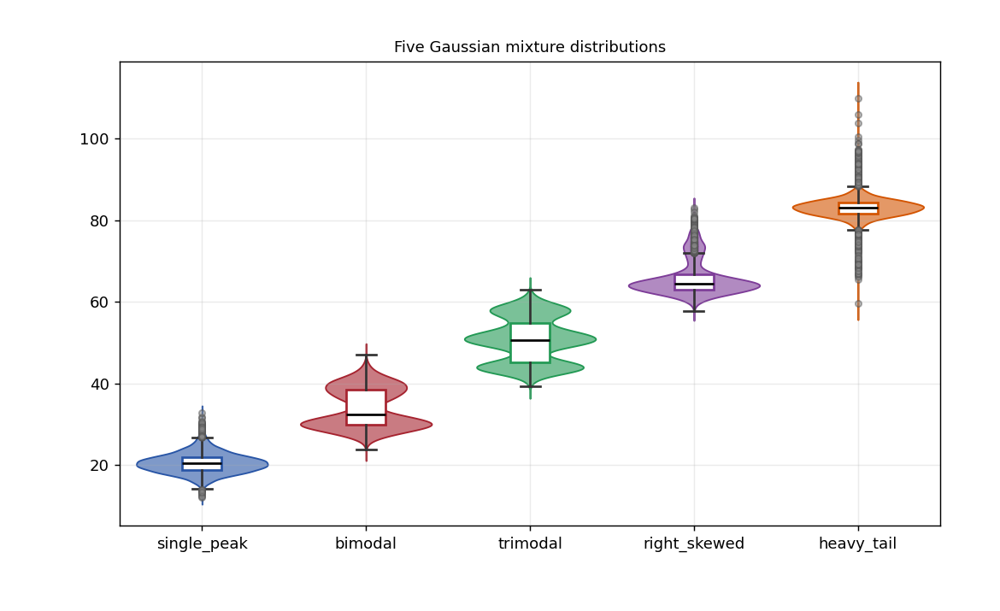

# csvGUI

csvGUI 包含两个 Tkinter 桌面绘图工具：**csvPLOT** 用于多曲线折线图和移动平均平滑，**csvFIG** 用于统计分布图。两者支持颜色、透明度、字体、坐标范围、画布设置、项目保存和多种图片格式导出。

| 工具 | 输入 | 图形 | 可编辑项目 |
| --- | --- | --- | --- |
| [csvPLOT](csvPLOT/) | CSV | 原始曲线、平滑曲线、多曲线叠加 | `.cplot` |
| [csvFIG](csvFIG/) | CSV | 纵/横箱线图、柱状误差图、小提琴图、小提琴与箱线组合图 | `.cfig` |

每个工具使用独立目录，数据示例与项目保存位置也分别管理；`common/` 存放共享界面和字体支持。后续 csvGUI 系列工具可按同样结构继续添加。

## 窗口与控件

以下截图来自实际运行的程序，使用仓库内的实验 CSV。主侧栏仅保留数据和常用样式，顶部不再显示灰色状态段落，主窗口没有侧栏滚动条。

### csvPLOT 主窗口



左侧依次是导入/项目操作、X/Y 选列、配色、平滑窗口、Hold、绘制/清空和重新平滑。下方的 **Figure & Axes...** 打开图形设置，**Advanced Settings...** 管理曲线和细节样式。右侧工具栏负责平移、缩放、布局调整和导出，图形以外为干净灰底。

### csvFIG 主窗口



默认不显示图例，横轴标签已说明分组。下图演示手动开启 Show legend 后的效果。左侧保留数据列、分组标签、颜色、宽度、图形类型和显隐选项。统计连线、标记和边框细节移到 **Advanced Settings → Distribution Style**。较长的横轴刻度标签发生重叠时会自动倾斜，并为标签预留底部空间。

### Figure & Axes 弹窗



**Plot Area & Font** 设置坐标区宽高、字体与字号，外围画布自动容纳文字。**Axes & Labels** 编辑标题、坐标标签、范围、刻度和网格。**Legend** 选择图例位置、列数和显示方式。





弹窗使用页签，不需要滚动。**Apply** 应用并继续编辑，**OK** 应用并关闭，**Cancel** 丢弃尚未应用的修改。输入无效范围或尺寸时保留当前图形并提示。

## 1. 安装与启动

需要 **Python 3.10+** 和可用的桌面显示环境。

| 依赖 | 要求 | 用途 |
| --- | --- | --- |
| NumPy | `numpy>=1.24` | 数组、平滑、统计、示例数据生成 |
| pandas | `pandas>=2.0` | CSV 读取与数据列转换 |
| Matplotlib | `matplotlib>=3.7` | 图形、嵌入式画布、工具栏、图片导出 |
| SciPy | `scipy>=1.10` | 小提琴图的高斯核密度估计 |
| Tkinter | 由 Python/操作系统提供 | 桌面界面，不通过 pip 安装 |

Windows PowerShell：

```powershell
git clone https://github.com/lbsun1999/csvGUI.git
cd csvGUI
python -m venv .venv
.venv\Scripts\Activate.ps1
python -m pip install -r requirements.txt
python csvPLOT/csvPLOT.py
# 或者
python csvFIG/csvFIG.py
```

`requirementLists.txt` 是兼容入口，引用同一份依赖版本，也可以这样安装：

```powershell
python -m pip install -r requirementLists.txt
```

macOS/Linux 通常使用 `python3`，虚拟环境激活命令为 `source .venv/bin/activate`。也可以不激活环境，直接调用虚拟环境中的 Python。Linux 若缺少 Tkinter，需要安装对应 Python 版本的 Tk 包，例如 Debian/Ubuntu 的 `python3-tk`。

```powershell
python -m tkinter
```

以上命令可以检查 Tkinter。两个工具分目录维护，共用 `common/` 中的界面和字体模块。请保留仓库结构；从仓库根目录或工具目录启动均可。

## 2. 实验数据与快速绘图

所有示例均为**人工合成的演示数据**，用于观察绘图、平滑及分布形状，不代表真实实验结果。大样本数据与原有的小样本示例分开存放。

| 文件 | 形状，不含表头 | 用途 |
| --- | --- | --- |
| [experiment_curves.csv](csvPLOT/examples/experiment_curves.csv) | 5000 行 × 6 列 | 行号 + 五条趋势、谐波和噪声曲线 |
| [experiment_distributions.csv](csvFIG/examples/experiment_distributions.csv) | 5000 行 × 5 列 | 五组高斯混合分布的原始观测 |
| [curves.csv](csvPLOT/examples/curves.csv) | 16 行 × 3 列 | 最小折线示例与回归测试 |
| [distributions.csv](csvFIG/examples/distributions.csv) | 12 行 × 3 列 | 最小分布示例与回归测试 |

### 2.1 五条实验曲线

运行 `csvPLOT.py`，点击 **Load CSV** 打开 `csvPLOT/examples/experiment_curves.csv`，X 选择 `row`。首列为 **1 到 5000 的行号**，其余列都同时包含线性项、三个谐波和噪声。

| Y 列 | 趋势 | 目标信噪比 | 建议颜色 |
| --- | --- | --- | --- |
| `slow_rising_snr20` | 截距 10，缓慢上升 | 20 dB | Royal Blue `#2855A6` |
| `fast_rising_snr12` | 截距 25，较快上升 | 12 dB | Deep Red `#A6232F` |
| `falling_snr6` | 截距 55，下降 | 6 dB | Forest Green `#229954` |
| `flat_snr10` | 截距 65，零斜率基线 | 10 dB | Purple `#7D3C98` |
| `gentle_rising_snr16` | 截距 80，轻微上升 | 16 dB | Burnt Orange `#D35400` |

1. 选择第一条 Y 曲线，设置 **Smoothing Window = 25**，选择颜色，点击 **Plot / Add**。
2. 勾选 **Hold: keep existing curves**，逐个添加其余四列，每次换一个颜色。
3. 全部添加后，在 **Advanced Settings** 修改标签、原始线透明度和图例。勾选 **Hide original data legends**，可以只保留平滑线的图例项，原始线仍显示。
4. 分别尝试窗口 **25、100、300**，每次修改后点击 **Re-smooth All Curves**。较大窗口会削弱噪声和短周期振荡，也会产生更明显的滞后。
5. 打开 **Figure & Axes → Axes & Labels**，将 X 范围设为 **1—5000**、Y 范围设为 **0—100**，再尝试 X 范围 **1000—2000**，点击 **Apply** 比较整体与局部。
6. 也可以勾选 Hold，给同一列重复添加不同窗口、不同颜色的版本，在同一图中比较平滑效果。建议曲线添加完成后再统一设置标签。

下面是使用该 CSV 绘制的示意效果，平滑窗口为 100：



### 2.2 五组实验分布

运行 `csvFIG.py`，打开 `csvFIG/examples/experiment_distributions.csv`。此文件**没有行号列**，五列都是观测数据。

| 数据列 | 分布特点 | 建议颜色 |
| --- | --- | --- |
| `single_peak` | 两个相邻高斯成分混合，形成一个主要峰 | Royal Blue |
| `bimodal` | 两个分离的峰 | Deep Red |
| `trimodal` | 三个峰 | Forest Green |
| `right_skewed` | 主体集中，右侧有较长尾部 | Purple |
| `heavy_tail` | 窄分布混入少量宽分布，离群点较多 | Burnt Orange |

1. 选择第一列，填写 **Label (display name)**、选择颜色，点击 **Add Data**。
2. 勾选 **Hold: keep existing data**，依次添加其余四列，每组使用不同颜色。
3. 切换 **Plot Type**，依次观察 `Box (V)`、`Box (H)`、`Bar+Err`、`Violin`、`Violin+Box`。
4. 对比箱体、中位数、上下须、离群点，以及小提琴图的单峰、双峰、多峰和尾部形状。
5. 尝试连接中位数或均值、调整边线宽度、切换黑色边框，在高级设置中调整透明度、标签和顺序。

这些列保存原始样本，统计值由程序计算。各列是独立总体，同一行不代表配对受试者。

下面是同一组原始观测的 Violin+Box 示例：



### 2.3 手动保存实验项目

两个工具各自的 `examples/projects/` 已预留给手动绘制后的项目。样式设置完成后，建议保存为：

```text
csvPLOT/examples/projects/experiment_curves.cplot
csvFIG/examples/projects/experiment_distributions.cfig
```

当前仓库准备了 CSV 和该目录，**尚未提供上述两个项目文件**，可以根据自己的绘图结果保存后再加入仓库。

## 3. csvPLOT 功能

### 3.1 数据与叠加

| 控件 | 功能 |
| --- | --- |
| **Load CSV** | 读取带表头的逗号分隔 CSV，自动尝试 UTF-8 BOM、UTF-8、GB18030、GBK、Latin-1 编码 |
| **X Column / Y Column** | 选择坐标列。Y 转换为数值，非数值、缺失值及无穷值不参与绘图 |
| **Curve Color** | 选择下一次添加曲线的颜色 |
| **Plot / Add** | 绘制选定列。X 支持数字、可解析的日期或文本，并按 X 排序 |
| **Hold** | 保留已有曲线，可从同一 CSV 或不同 CSV 继续添加 |
| **Clear** | 清空当前曲线和标题 |

默认标签为 `Y列名 (CSV文件名)`，可在高级设置中修改。当前界面每次添加一条 Y 曲线。

### 3.2 平滑与线条样式

平滑为**后向移动平均**：每个点只使用当前点及之前最多 `W-1` 个点，开头不足 `W` 个点时使用已有数据。窗口按数据点数计量，**新建窗口默认值为 25**。打开项目时恢复项目中保存的平滑窗口；旧项目未记录时使用 25。

| 控件 | 功能 |
| --- | --- |
| **Smoothing Window** 留空或为 `1` | 关闭平滑线 |
| **Smoothing Window > 1** | 同时显示原始线和平滑线，窗口必须为正整数 |
| **Re-smooth All Curves** | 用当前窗口统一重算已有曲线，包括暂时隐藏的曲线 |
| **Original Line Alpha** | 原始线透明度 `0–1`，默认 `0.3` |
| **Smooth Darken Factor** | 平滑线相对于所选颜色的明暗系数 `0.3–1`，越小越深 |
| **Smooth Line Width** | 平滑线宽 `0.5–5` |

后三项位于 **Advanced Settings → Curve Style**，更改后点击 **Apply**。重新平滑保留原始数据及曲线显隐状态。

### 3.3 曲线列表与图例

**Advanced Settings → Curves on Plot** 支持：逐条显隐、标签修改、点击颜色块重新选色、**↑ / ↓** 排序，以及 **Delete** 删除单条曲线。显隐会同时影响该数据的原始线和平滑线，图例按曲线列表顺序排列。

**Figure & Axes → Legend** 提供以下设置，高级设置中也保留图例调整入口：

| 控件 | 功能 |
| --- | --- |
| **Columns** | 图例列数 |
| **Location** | 自动位置 `best`，或图内上、下、左、右、中心等位置 |
| **outside upper / lower / right** | 将图例放在坐标区外侧，避开坐标标签和标题，并自动扩展画布边距 |
| **Hide all legends** | 隐藏整个图例 |
| **Hide original data legends** | 隐藏原始线对应的图例项，保留平滑线图例项 |

原始线和平滑线默认可以各自生成图例项，因此可能出现同名项。使用 **Hide original data legends** 可以精简图例。

## 4. csvFIG 功能

### 4.1 输入与分组

**Load CSV** 读取带表头的 CSV，**Data Column** 选择一列原始观测，过滤非数值、缺失值和无穷值。**Add Data** 添加数据，**Hold** 保留已有分组，**Clear** 清空画布。

导入区与 csvPLOT 一致：上方为整行 **Load CSV**，下一行为 **Save Project / Open Project**。

**Label (display name)** 设置添加时的标签。已添加分组的标签和颜色可以在高级设置中修改。程序防止连续重复添加当前列；添加其他组时切换数据列，或清空后重新开始。

### 4.2 图形类型

| Plot Type | 图形及含义 |
| --- | --- |
| **Box (V)** | 纵向箱线图。箱体为 Q1 到 Q3，黑线为中位数，上下须按 `1.5×IQR` 规则确定，须外样本为离群点 |
| **Box (H)** | 横向箱线图，数值轴变为 X 轴 |
| **Bar+Err** | 柱高为均值，误差范围由箱线图上下须确定，**不是标准差、标准误或置信区间** |
| **Violin** | 从原始样本进行高斯核密度估计，显示分布形状和中位数线 |
| **Violin+Box** | 小提琴轮廓上叠加较窄的白色箱线图，同时展示密度和四分位数 |

切换类型复用当前数据，无需重新导入。小提琴宽度按每组自身的最大密度归一化，用于比较形状，不能据此比较样本量。

### 4.3 样式与数据项管理

| 控件 | 功能 |
| --- | --- |
| **Relative Width** | 相对宽度 `0.1–1.0`。添加前控制新数据，拖动时统一更新已有数据项 |
| **Show outliers (Box)** | 显示/隐藏箱线图和组合图中的离群点 |
| **Connect medians** | 用圆点连接各组中位数 |
| **Connect means** | 用三角标记连接各组均值 |
| **Median Line Style** | 实线、虚线、点划线、点线或无线段，均值与中位数连线共用此设置 |
| **Median Marker Size** | 统计连线标记尺寸 `0–15`，设为 `0` 隐藏标记 |
| **Edge / Line Width** | 箱体边缘、须、小提琴轮廓及统计连线线宽，范围 `0.5–5` |
| **Edges: Color / Black** | 在数据配色边框和黑色边框之间切换 |
| **Show legend** | 显示当前启用的 Median、Mean、Outliers 等统计元素说明 |
| **Global Box Alpha** | 高级设置中的整体透明度 `0–1`，Apply 后应用于所有数据项 |

csvFIG **默认不显示图例**，各组名称由坐标轴标签说明。需要时可以手动勾选 **Show legend**，显示各组颜色及名称，以及中位数、均值与离群点的说明。打开项目时恢复其保存的图例开关。分簇箱线图计划后续添加，当前版本尚不支持。**Figure & Axes → Legend** 支持 `best` 自动选择、指定图内位置、图外位置与列数，这些设置会保存到 `.cfig` 项目。

统计连线、连线样式、标记尺寸和边框细节位于 **Advanced Settings → Distribution Style**。

**Advanced Settings → Data Items on Plot** 支持逐组显隐、修改标签、重新选色和 **↑ / ↓** 排序。隐藏后，其余可见组重新排列。部分选项在重绘时生效，修改后可在高级设置中点击 **Apply** 统一刷新。

## 5. 画布、坐标区、字体与工具栏

主窗口侧栏没有滚动条，右侧为 Matplotlib 画布。窗口可缩放，起始窗口为 `1280×820`。点击 **Figure & Axes...** 在弹窗中调整图形设置。高级设置中的数据列表可滚动，以支持较多曲线或分组。

### 5.1 Figure & Axes

| 控件 | 功能 |
| --- | --- |
| **Axes Width / Axes Height (inches)** | 坐标区内部宽高，单位英寸，默认 `9×5.5`，必须为正数；不包含刻度、标签、标题和图例 |
| **Font / Font Size** | 标题、坐标标签和刻度字体与字号，字号必须为正数 |
| **X Axis: min—step—max** | csvPLOT 的 X 范围与固定主刻度间隔 |
| **Y Axis: min—step—max** | 两个工具的数值轴范围与固定主刻度间隔 |
| **Hide last X / Y tick** | 隐藏最后一个主刻度标签，不删除数据；csvFIG 仅提供数值轴选项 |
| **Apply / OK** | 应用弹窗内的画布、字体、坐标与图例设置 |

范围上下限可单独指定，留空的范围自动缩放。固定刻度间隔应为正数。csvFIG 在 `Box (H)` 模式下，面板中名为 **Y Axis** 的范围、步长和末刻度选项实际应用到横向数值轴。

**Axes & Labels** 页签可编辑 **Plot Title、X-Axis Label、Y-Axis Label** 及 X/Y 网格。较长的横轴刻度标签重叠时自动旋转 45°，恢复空间后重新水平排列。

程序优先使用已找到的 **TimesSimSun**，适合宋体中文和 Times New Roman 英文混排。将有权使用的字体文件放入 `common/fonts/`，重启后自动注册，不需要在系统中安装。没有该字体时使用 Matplotlib 自带字体，也可以选择本机已安装的中文字体。字体下拉框还支持手动输入名称。

TimesSimSun 的用户提供来源为公众号 **阿昆的科研日常**，[原文链接](https://mp.weixin.qq.com/s/Z--wuiasKW90wUn2dsC5kw)。本地副本已接入字体；公开仓库不包含字体二进制，获取来源不等于原字体的再分发许可，详见 [fonts/README.md](common/fonts/README.md)。

坐标区是坐标轴边框以内的数据绘制区域。程序按字体和字号测量刻度、轴标签、标题及图例，在四周自动增加画布空间，保持指定的坐标区宽高；长横轴刻度标签重叠时自动倾斜。缩小坐标区或增大字号时，文字仍会被纳入画布；减小字号或缩短文字后，多余边距也会收回。

例如设置 `Axes Width=4`、`Axes Height=3`，导出图中的坐标区为 `4×3` 英寸，完整图片会更大，具体大小随文字与图例变化。外置图例会排列在坐标标签和标题之外。很密集的标签仍可通过加宽坐标区、缩短标签或减小字号来改善相互遮挡。

调整尺寸后只保留当前图像，空余区域使用灰色背景。完整画布大于显示区域时按比例缩小预览，导出仍保留指定的坐标区英寸尺寸和原始 DPI。

### 5.2 工具栏

| 工具 | 功能 |
| --- | --- |
| **Home** | 返回初始视图 |
| **Back / Forward** | 切换视图历史 |
| **Pan** | 拖动平移 |
| **Zoom** | 框选放大局部区域 |
| **Subplots** | 打开同一个 Figure & Axes 弹窗，设置坐标区大小、文字与图例 |
| **Save** | 导出当前图形 |

交互缩放不修改 CSV 数据。平移、缩放或修改设置后，程序会自动重算外围边距，导出时也会使用当前布局。

## 6. 色卡与自定义颜色

两个工具共用以下 13 色。主面板为下一条曲线或下一组数据选色，高级设置的颜色块修改已经绘制的数据。

| 名称 | 颜色值 | 名称 | 颜色值 |
| --- | --- | --- | --- |
| Deep Red | `#A6232F` | Red | `#C0392B` |
| Burnt Orange | `#D35400` | Orange | `#CA6F1E` |
| Amber | `#B7950B` | Olive | `#7D8C3A` |
| Forest Green | `#229954` | Teal | `#16A085` |
| Ocean Blue | `#2E86C1` | Royal Blue | `#2855A6` |
| Indigo | `#4A235A` | Purple | `#7D3C98` |
| Plum | `#9B1B6B` | | |

取色窗口支持预设颜色、颜色值输入、**Picker…** 系统取色器及颜色预览。为保证 Tkinter 色块与绘图一致，自定义颜色建议使用 `#RRGGBB`。透明度通过 Alpha 控件设置，`0` 为透明，`1` 为不透明。

## 7. 图片导出与项目保存

### 7.1 图片格式

点击工具栏 **Save**。常用格式如下，具体以当前环境保存对话框为准。

| 类型 | 格式 | 使用场景 |
| --- | --- | --- |
| 位图 | PNG、JPEG/JPG、TIFF/TIF、WebP | 文档插图、网页、常规图像展示 |
| 矢量图 | PDF、SVG/SVGZ | 论文和后续排版，保留文字及线条缩放能力 |
| PostScript | EPS、PS | 需要这些格式的排版流程 |

界面没有单独的导出 DPI 输入框，默认导出按初始 100 DPI 生成，完整图片像素尺寸取决于指定的坐标区大小及自动测得的外围边距，预览缩放不会降低导出尺寸。JPEG 不保留透明背景，EPS/PS 不完整支持透明度。需要透明效果时可使用 PNG、PDF 或 SVG。工具栏还可能提供 PGF、RAW/RGBA 等格式，其中 PGF 通常需要本机 TeX 环境。

### 7.2 可编辑项目

**Save Project** 保存数据与程序支持的设置，**Open Project** 重新加载。

| 内容 | `.cplot` | `.cfig` |
| --- | --- | --- |
| 数据 | 原始曲线、已有平滑线 | 各组原始观测 |
| 样式 | 标签、颜色、显隐、顺序、透明度、平滑线样式 | 标签、颜色、显隐、顺序、透明度、宽度、图形类型 |
| 设置 | 标题、轴标签、范围、步长、字体、网格、图例布局 | 标题、轴标签、数值轴设置、字体、网格、统计元素选项 |
| 继续编辑 | 修改平滑窗口后统一重算 | 重新计算统计值并切换图形类型 |

项目文件使用 JSON，包含已绘制的数据，不依赖原 CSV 路径。工具栏的临时缩放历史不会持久化，需保存的范围建议写入 Figure & Axes 弹窗。

导出的图片不能通过 Open Project 恢复为可编辑项目。项目扩展名统一使用小写 `.cplot`、`.cfig`。

## 8. 实验数据生成方法

生成器 [generate_examples.py](examples/generate_examples.py) 仅依赖 NumPy。默认重建两份大样本 CSV 和 [dataset_metadata.json](examples/dataset_metadata.json)，不修改小样本示例，不生成项目文件。

```powershell
python examples/generate_examples.py
# 将数据另存到独立目录
python examples/generate_examples.py --output-dir E:\my_csv_examples
```

### 8.1 曲线模型与 SNR

设 `t = row - 1`：

```text
y(t) = b + m*t + h(t) + noise(t)
h(t) = Σ A_k * sin(2π*k*t/1000 + k*phase + offset_k)
k = [1, 3, 10]
offset = [0, 0.4, 0.8] rad
```

谐波周期分别为 **1000、约 333.3、100 个采样点**。随机种子为 **20261023**。高斯噪声生成后去均值，并按有限样本功率归一化。

| 列 | 截距 b | 斜率 m | 谐波振幅 | phase，rad | SNR，dB |
| --- | --- | --- | --- | --- | --- |
| `slow_rising_snr20` | 10 | 0.006 | 4 / 1.8 / 0.9 | 0.0 | 20 |
| `fast_rising_snr12` | 25 | 0.009 | 5 / 2.4 / 1.2 | 0.5 | 12 |
| `falling_snr6` | 55 | -0.005 | 4.5 / 1.8 / 1.0 | 1.0 | 6 |
| `flat_snr10` | 65 | 0 | 3 / 1.5 / 0.8 | 0.8 | 10 |
| `gentle_rising_snr16` | 80 | 0.002 | 5 / 2.0 / 1.0 | 1.5 | 16 |

信噪比定义为 `10*log10(mean(h²)/mean(noise²))`，**不把截距或线性趋势计入信号功率**，避免不同截距虚增名义信噪比。数据保留 6 位小数，舍入后实测 SNR、参数和统计摘要保存在元数据 JSON 中。

### 8.2 分布模型

随机种子为 **20261024**。每列是若干正态分布 `N(均值, 标准差²)` 的混合，按权重精确分配各成分数量，总计 5000 个样本，再独立打乱顺序。

| 列 | 权重 | 成分均值 | 成分标准差 |
| --- | --- | --- | --- |
| `single_peak` | 0.7 / 0.3 | 20 / 22 | 2 / 3 |
| `bimodal` | 0.55 / 0.45 | 30 / 39 | 1.8 / 2.4 |
| `trimodal` | 0.30 / 0.45 / 0.25 | 44 / 51 / 58 | 1.4 / 1.8 / 1.6 |
| `right_skewed` | 0.8 / 0.2 | 64 / 73 | 1.8 / 3.0 |
| `heavy_tail` | 0.9 / 0.1 | 83 / 83 | 1.8 / 7.0 |

元数据同时记录每列的样本量、均值、样本标准差、最小值、Q1、中位数、Q3 和最大值。

## 9. 文件结构与检查

```text
csvPLOT/
  csvPLOT.py                  折线图工具
  README.md                   工具入口与示例说明
  requirements.txt            工具依赖入口
  requirementLists.txt        兼容依赖入口
  examples/                   CSV、预览和 projects/ 项目目录
csvFIG/
  csvFIG.py                   分布图工具
  README.md                   工具入口与示例说明
  requirements.txt            工具依赖入口
  requirementLists.txt        兼容依赖入口
  examples/                   CSV、预览和 projects/ 项目目录
common/
  plot_ui.py                  共用字体、画布与设置弹窗
  fonts/                      本地字体与来源说明
examples/
  generate_examples.py        两个工具的实验数据生成器
  dataset_metadata.json       种子、参数、SNR 和摘要
docs/screenshots/             实际窗口与控件截图
tests/                        数值与 GUI 工作流检查
requirements.txt              系列共用依赖
requirementLists.txt           兼容依赖入口
LICENSE                       MIT 许可证
```

```powershell
python -m unittest discover -s tests -v
```

GUI 测试需要显示环境，无显示服务器的 Linux 环境需使用虚拟显示服务器。

| 现象 | 处理方式 |
| --- | --- |
| 中文显示为方框 | 选择本机已安装的中文字体 |
| 修改选列后画布没变 | 点击 Plot / Add 或 Add Data |
| 新数据覆盖旧数据 | 添加前勾选 Hold |
| 改平滑窗口后已有曲线没变 | 点击 Re-smooth All Curves |
| 图例同名项重复 | 在 csvPLOT 勾选 Hide original data legends |
| 想调整图例位置 | 打开 Figure & Axes → Legend，选择 best 或指定位置 |
| 不能连续添加当前列 | 切换其他列或清空重绘 |
| 想查看数值轴局部 | 修改 Figure & Axes 范围或使用 Zoom |

## 10. 版本范围与许可证

此版本以原 `csvPLOT.py` 和 `csvFIG.py` 为基础，保留绘图、平滑、样式编辑、项目保存和图片导出。不包含 `csvPLOT_v2.py` 的批量导入界面或 `seqPLOT.py`，也不包含 LP 变换、曲线加权合成、统计值手工编辑、分布线性映射或根据汇总值生成替代观测的功能。

普通 v1 `.cplot` 可继续打开，旧 LP 配置不再执行，已经保存在数据数组中的结果作为普通曲线读取。新项目记录日期和文本 X 轴的类型。

新项目在设置中记录 `size_mode: axes`，宽高表示坐标区尺寸。旧项目的宽高表示完整画布，打开时会按原布局比例换算为坐标区尺寸，再自动容纳文字；保存后使用新的尺寸含义。

`.cfig` 必须包含原始观测，载入后重算统计值。仅有汇总值的旧项目需重新导入 CSV；手工修改的统计值不会覆盖原始观测，已经保存在观测数组中的映射结果作为普通数据读取。

采用 [MIT 许可证](LICENSE)。源代码仓库：[lbsun1999/csvGUI](https://github.com/lbsun1999/csvGUI)。
