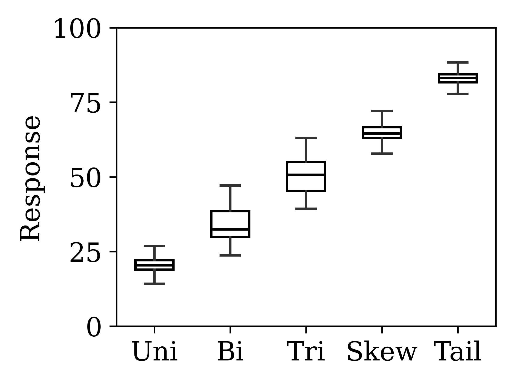
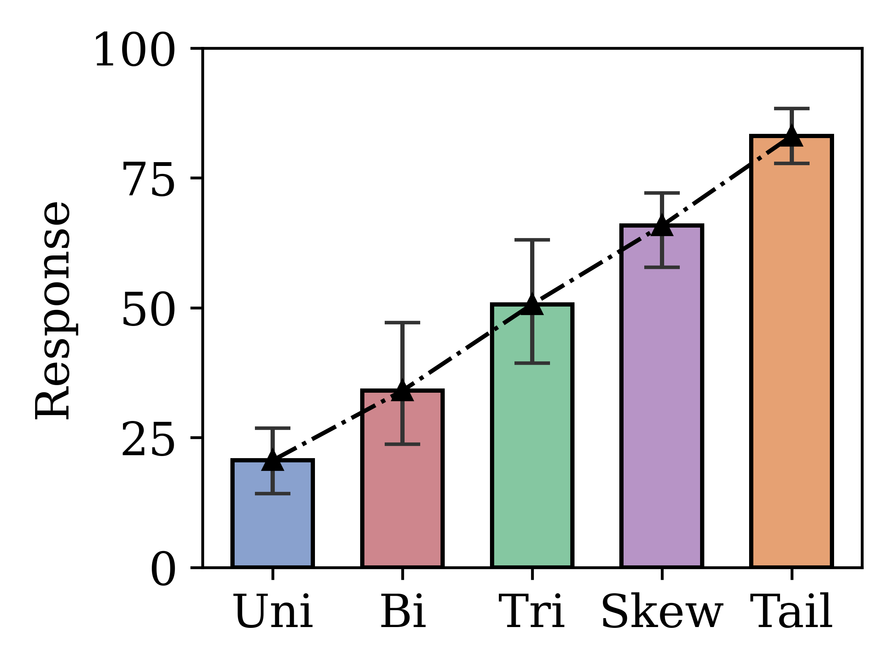
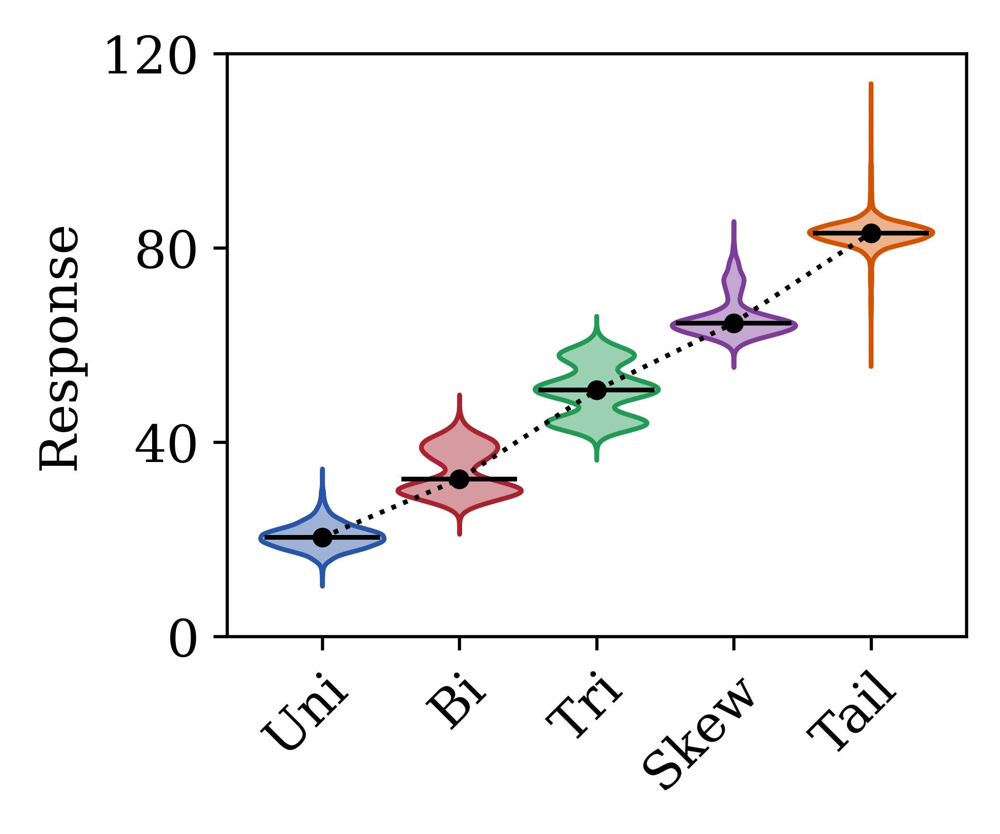
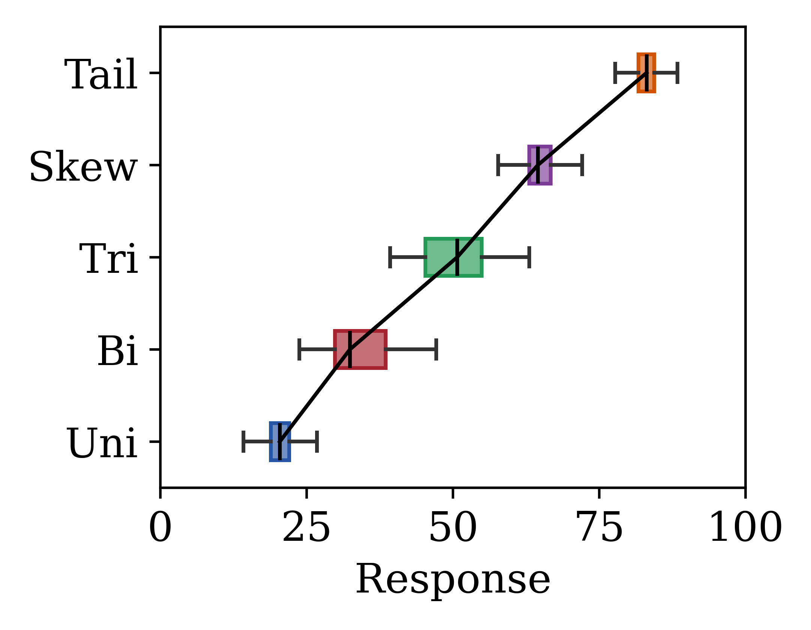
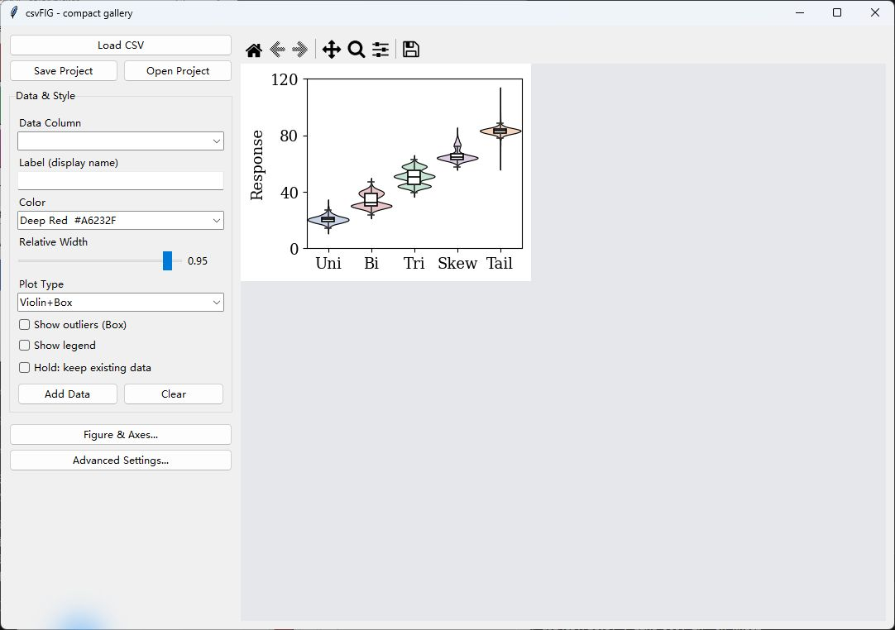
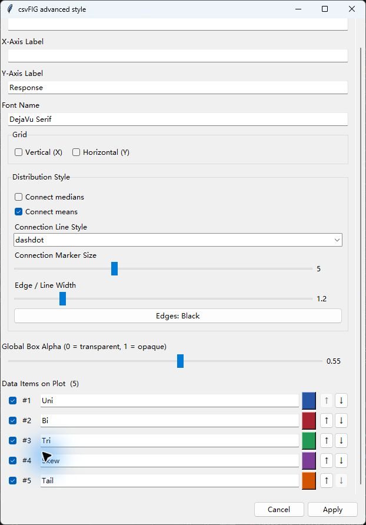
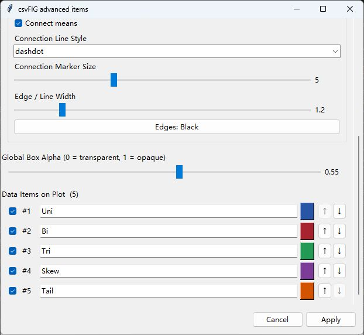
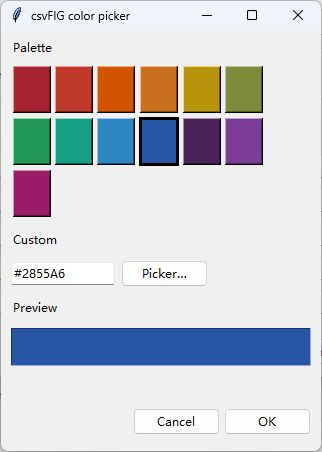

# csvFIG

统计分布绘图与期刊插图排版。[系列首页](../README.md) · [实验 CSV](examples/experiment_distributions.csv)

```powershell
# 从仓库根目录启动
python csvFIG/csvFIG.py
```

也可以在本目录执行 `python csvFIG.py`。首次使用请按[主 README](../README.md)安装依赖，并保留同级的 `common/` 目录。

## 四类图形与横向箱线图

每张图都提供 **600 DPI PNG、矢量 PDF/SVG 和含原始观测的 `.cfig` 项目**。所有图片均由对应项目重开后导出，项目中的样式与图片一致。

使用 **2.6 × 2.05 英寸坐标区、13 pt 字体**，短分组标签、白底、少量刻度，默认无图例；无内置标题，方便在论文中统一安排图注与子图编号。完整画布会随自动倾斜的标签及其他文字调整，具体英寸尺寸见[图集清单](../examples/gallery_manifest.json)。

| 箱线图 · Box (V) | 柱状误差图 · Bar+Err |
| --- | --- |
|  |  |
| [PNG](examples/exports/box.png) · [PDF](examples/exports/box.pdf) · [SVG](examples/exports/box.svg) · [box.cfig](examples/projects/box.cfig) | [PNG](examples/exports/bar-error.png) · [PDF](examples/exports/bar-error.pdf) · [SVG](examples/exports/bar-error.svg) · [bar-error.cfig](examples/projects/bar-error.cfig) |
| 小提琴图 · Violin | 小提琴与箱线组合 · Violin+Box |
|  |  |
| [PNG](examples/exports/violin.png) · [PDF](examples/exports/violin.pdf) · [SVG](examples/exports/violin.svg) · [violin.cfig](examples/projects/violin.cfig) | [PNG](examples/exports/violin-box.png) · [PDF](examples/exports/violin-box.pdf) · [SVG](examples/exports/violin-box.svg) · [violin-box.cfig](examples/projects/violin-box.cfig) |

### 横向箱线图 · Box (H)



[PNG](examples/exports/box-horizontal.png) · [PDF](examples/exports/box-horizontal.pdf) · [SVG](examples/exports/box-horizontal.svg) · [box-horizontal.cfig](examples/projects/box-horizontal.cfig)

这是箱线图的横向排布，所以程序有五个 Plot Type 选项，对应四类图形。分簇箱线图将在后续加入。

### 图中数据与绘制约定

| 标签 | 数据列 | 颜色与分布 |
| --- | --- | --- |
| Uni | `single_peak` | 蓝色，单峰混合 |
| Bi | `bimodal` | 红色，双峰 |
| Tri | `trimodal` | 绿色，三峰 |
| Skew | `right_skewed` | 紫色，右偏 |
| Tail | `heavy_tail` | 橙色，厚尾 |

每组均为 **5000 个原始观测**。五张图故意使用不同的透明度、宽度、边框和统计连线，参数如下。边线宽度统一为 1.2，字体使用 Matplotlib 自带的 DejaVu Serif；中文图可切换 TimesSimSun。

| 示例项目 | 填充 Alpha | 相对宽度 | 边框 | 组间统计连线 | 线型 / 标记大小 |
| --- | --- | --- | --- | --- | --- |
| `box.cfig` | 0 | 0.50 | 全黑 | 无 | 无标记 |
| `bar-error.cfig` | 0.55 | 0.62 | 黑色 | 均值，三角标记 | dashdot / 5 |
| `violin.cfig` | 0.45 | 0.90 | 随组颜色 | 中位数，圆点标记 | dotted / 4 |
| `violin-box.cfig` | 0.25 | 0.95 | 黑色 | 无 | 无标记 |
| `box-horizontal.cfig` | 0.65 | 0.40 | 随组颜色 | 中位数，仅线段 | solid / 0 |

表中的连线连接不同分组的统计值，仅展示样式功能；这些合成分组是独立总体，连线不表示配对关系或时间趋势。颜色表描述彩色示例，黑白箱线图将所有组设置为黑色。

为避免厚尾数据的大量离群点挤满紧凑画面，箱线图和组合图示例关闭 **Show outliers**；样本仍完整保存在项目里，可随时勾选显示。小提琴密度使用全部样本。箱线图/柱状图数值轴为 0–100，小提琴/组合图为 0–120，比较时请留意刻度。**Bar+Err 的误差条表示箱线图上下须，不是标准差、标准误或置信区间。**

## 直接从项目继续编辑

1. 点击 **Open Project**，选择 `examples/projects/` 中对应的 `.cfig`。
2. 项目自动恢复数据、图形类型、轴标签、字号、配色和无图例设置。
3. 修改 **Plot Type** 可复用同一组数据绘制其他形式；选择 Box (H) 后可同步调整轴标签。
4. **Figure & Axes** 修改坐标区大小与数值轴范围；**Advanced Settings** 修改标签、颜色、透明度、顺序、统计连线等。
5. 工具栏 **Save** 导出图片，**Save Project** 另存可编辑项目。

## 实际窗口与控件



左侧为 CSV 导入、项目保存/打开、数据列、标签、颜色、宽度和图形类型。Hold 支持多组叠加。**Figure & Axes** 打开坐标与画布弹窗，**Advanced Settings** 打开数据项及统计样式设置。顶部不显示状态文字，主面板无需滚动。

## 高级设置截图与操作顺序

### 1. 连线、线型、标记、边框与透明度



截图加载的是 `bar-error.cfig`：勾选 Connect means、使用 dashdot、标记大小 5、黑色边框、Alpha 0.55。高级设置窗口内可滚动，同时可编辑标题、轴标签、字体和网格；Apply 与 Cancel 固定在底部。

| 控件 | 操作与效果 | 生效方式 |
| --- | --- | --- |
| **Connect medians** | 连接各组中位数，圆点标记 | 勾选即重绘 |
| **Connect means** | 连接各组均值，三角标记 | 勾选即重绘 |
| **Connection Line Style** | 选择 solid、dashed、dashdot、dotted 或 none；均值和中位数共用 | 选中即重绘 |
| **Connection Marker Size** | 0–15；0 隐藏标记，但仍可保留连线 | 拖动即重绘 |
| **Edge / Line Width** | 0.5–5，调整轮廓、须和统计连线线宽 | 拖动即重绘 |
| **Edges: Color / Black** | 点击切换；按钮文字显示当前模式，Black 为黑边，Color 跟随各组颜色 | 点击即重绘 |
| **Global Box Alpha** | 0 为无填充，1 为不透明；输入框对应的是填充，不会同时隐藏边框 | 拖动后点 Apply，统一应用到所有组 |

solid 为实线，dashed 为虚线，dashdot 为点划线，dotted 为点线。选择 `none` 并保留非零标记大小，可得到“只显示统计点、不连线”；标记大小为 0 且选非 none，可得到“只连线、不打点”。两者都关闭时不显示组间统计连接。箱体内部的中位数线不受这个连线开关影响，仍然显示。

**Connection Line Style / Marker Size** 是以前 Median Line Style / Marker Size 的新名称，项目文件中的旧字段仍兼容。它们控制均值、中位数的组间连接，不会把箱线图每条须或箱体边缘改成虚线。

打开窗口时，Alpha 显示第一组的当前值。各组 Alpha 不同时，未拖动该控件直接 Apply 会保留各组原值；调整后 Apply 才会统一它们。连线、线型和边框为即时设置，Cancel 关闭窗口不会回滚已经即时应用的改变；尚未 Apply 的 Alpha、标签和显隐修改则不会提交。

### 2. 分组标签、显隐、顺序与颜色



每行从左到右为：显示开关、组序号、标签输入框、颜色块和上移/下移按钮。标签和显隐在 Apply 后生效；隐藏一组会让其余组重新排布。上移/下移会重绘图形并重新打开设置窗口，调整前建议先 Apply 尚未提交的编辑。



点击**已绘制数据行的色块**，可从 Palette 选择预设色，或在 Custom 中输入 `#RRGGBB`（例如黑色 `#000000`）；Preview 显示当前选色，**OK** 才应用给这一组。Picker… 打开系统选色器。主窗口的 Color 用于下一次 Add Data；修改已有分组请使用这些色块。

### 3. 调整“胖瘦”

主窗口 **Relative Width** 范围为 0.1–1.0，拖动后会立即将当前所有分组统一为这一宽度；新添加的组也使用当前值。数值小则箱体、柱子或小提琴更窄，数值大则更宽，组中心位置保持不变。

- Box (V)：调整箱体的水平宽度；Box (H)：调整横向箱体的垂直厚度。
- Bar+Err：调整柱宽；误差条端帽大小由绘图程序固定，不能用这个滑块单独调整。
- Violin：调整小提琴在分类轴方向的最大宽度，不改变原始观测或 KDE 带宽。
- Violin+Box：同时调整外层小提琴和内层箱体，内层箱体宽度保持为外层的约 30%。

### 4. 黑白空心箱线图的完整做法

直接打开 [box.cfig](examples/projects/box.cfig) 就能看到效果，也可以从任一分布项目开始：

1. Plot Type 选择 **Box (V)** 或 **Box (H)**。
2. 在高级设置中点击各组色块，将颜色设成 `#000000`；或者直接把边框模式切到 **Edges: Black**，保留各组原配色以便以后切回。
3. **Global Box Alpha** 调到 **0**，点击 **Apply**。填充消失，黑色轮廓、须、端帽及中位数线仍保留。
4. 关闭 **Connect medians / Connect means**，用 Relative Width 调整胖瘦；本例用 0.50。
5. 如需观察须外点，勾选 **Show outliers (Box)**。离群点为程序固定的灰色小圆点，Alpha 只影响填充，不控制这些点。

这里的 Alpha=0 是“箱体不填充”，不是将导出图片背景设为透明。边框开关主要控制箱体、柱体和小提琴轮廓；须与端帽固定为深灰，中位数及统计连接固定为黑色。组合图内层箱体有固定的白色填充；要获得传统空心箱线图，请选择 Box 类型。

## csvFIG 功能

### 输入与分组

**Load CSV** 读取带表头的 CSV，**Data Column** 选择一列原始观测，过滤非数值、缺失值和无穷值。**Add Data** 添加数据，**Hold** 保留已有分组，**Clear** 清空画布。

导入区与 csvPLOT 一致：上方为整行 **Load CSV**，下一行为 **Save Project / Open Project**。

**Label (display name)** 设置添加时的标签。已添加分组的标签和颜色可以在高级设置中修改。程序防止连续重复添加当前列；添加其他组时切换数据列，或清空后重新开始。

### 图形类型

| Plot Type | 图形及含义 |
| --- | --- |
| **Box (V)** | 纵向箱线图。箱体为 Q1 到 Q3，黑线为中位数，上下须按 `1.5×IQR` 规则确定，须外样本为离群点 |
| **Box (H)** | 横向箱线图，数值轴变为 X 轴 |
| **Bar+Err** | 柱高为均值，误差范围由箱线图上下须确定，**不是标准差、标准误或置信区间** |
| **Violin** | 从原始样本进行高斯核密度估计，显示分布形状和中位数线 |
| **Violin+Box** | 小提琴轮廓上叠加较窄的白色箱线图，同时展示密度和四分位数 |

切换类型复用当前数据，无需重新导入。小提琴宽度按每组自身的最大密度归一化，用于比较形状，不能据此比较样本量。

### 样式与数据项管理

| 控件 | 功能 |
| --- | --- |
| **Relative Width** | 相对宽度 `0.1–1.0`。添加前控制新数据，拖动时统一更新已有数据项 |
| **Show outliers (Box)** | 显示/隐藏箱线图和组合图中的离群点 |
| **Connect medians** | 用圆点连接各组中位数 |
| **Connect means** | 用三角标记连接各组均值 |
| **Connection Line Style** | 实线、虚线、点划线、点线或无线段，均值与中位数连线共用此设置 |
| **Connection Marker Size** | 统计连线标记尺寸 `0–15`，设为 `0` 隐藏标记 |
| **Edge / Line Width** | 箱体边缘、须、小提琴轮廓及统计连线线宽，范围 `0.5–5` |
| **Edges: Color / Black** | 在数据配色边框和黑色边框之间切换 |
| **Show legend** | 显示当前启用的 Median、Mean、Outliers 等统计元素说明 |
| **Global Box Alpha** | 高级设置中的整体透明度 `0–1`，调整后 Apply 应用于所有数据项 |

csvFIG **默认不显示图例**，各组名称由坐标轴标签说明。需要时可以手动勾选 **Show legend**，显示各组颜色及名称，以及中位数、均值与离群点的说明。打开项目时恢复其保存的图例开关。分簇箱线图计划后续添加，当前版本尚不支持。**Figure & Axes → Legend** 支持 `best` 自动选择、指定图内位置、图外位置与列数，这些设置会保存到 `.cfig` 项目。

统计连线、连线样式、标记尺寸和边框细节位于 **Advanced Settings → Distribution Style**。

**Advanced Settings → Data Items on Plot** 支持逐组显隐、修改标签、重新选色和 **↑ / ↓** 排序。隐藏后，其余可见组重新排列。部分选项在重绘时生效，修改后可在高级设置中点击 **Apply** 统一刷新。

## 画布、坐标区、字体与工具栏

主窗口侧栏没有滚动条，右侧为 Matplotlib 画布。窗口可缩放，起始窗口为 `1280×820`。点击 **Figure & Axes...** 在弹窗中调整图形设置。高级设置中的数据列表可滚动，以支持较多曲线或分组。

### Figure & Axes

| 控件 | 功能 |
| --- | --- |
| **Axes Width / Axes Height (inches)** | 坐标区内部宽高，单位英寸，默认 `9×5.5`，必须为正数；不包含刻度、标签、标题和图例 |
| **Font / Font Size** | 标题、坐标标签和刻度字体与字号，字号必须为正数 |
| **X Axis: min—step—max** | csvPLOT 的 X 范围与固定主刻度间隔 |
| **Y Axis: min—step—max** | 两个工具的数值轴范围与固定主刻度间隔 |
| **Hide last X / Y tick** | 隐藏最后一个主刻度标签，不删除数据；csvFIG 仅提供数值轴选项 |
| **Apply / OK** | 应用弹窗内的画布、字体、坐标与图例设置 |

范围上下限可单独指定，留空的范围自动缩放。固定刻度间隔应为正数。csvFIG 在 `Box (H)` 模式下，面板中名为 **Y Axis** 的范围、步长和末刻度选项实际应用到横向数值轴。

**Axes & Labels** 页签可编辑 **Plot Title、X-Axis Label、Y-Axis Label** 及 X/Y 网格。较长的横轴刻度标签重叠时自动旋转 45°，恢复空间后重新水平排列。

程序优先使用已找到的 **TimesSimSun**，适合宋体中文和 Times New Roman 英文混排。将有权使用的字体文件放入 `../common/fonts/`，重启后自动注册，不需要在系统中安装。没有该字体时使用 Matplotlib 自带字体，也可以选择本机已安装的中文字体。字体下拉框还支持手动输入名称。

TimesSimSun 的用户提供来源为公众号 **阿昆的科研日常**，[原文链接](https://mp.weixin.qq.com/s/Z--wuiasKW90wUn2dsC5kw)。本地副本已接入字体；公开仓库不包含字体二进制，获取来源不等于原字体的再分发许可，详见 [fonts/README.md](../common/fonts/README.md)。

坐标区是坐标轴边框以内的数据绘制区域。程序按字体和字号测量刻度、轴标签、标题及图例，在四周自动增加画布空间，保持指定的坐标区宽高；长横轴刻度标签重叠时自动倾斜。缩小坐标区或增大字号时，文字仍会被纳入画布；减小字号或缩短文字后，多余边距也会收回。

例如设置 `Axes Width=4`、`Axes Height=3`，导出图中的坐标区为 `4×3` 英寸，完整图片会更大，具体大小随文字与图例变化。外置图例会排列在坐标标签和标题之外。很密集的标签仍可通过加宽坐标区、缩短标签或减小字号来改善相互遮挡。

调整尺寸后只保留当前图像，空余区域使用灰色背景。完整画布大于显示区域时按比例缩小预览，导出仍保留指定的坐标区英寸尺寸和原始 DPI。

### 工具栏

| 工具 | 功能 |
| --- | --- |
| **Home** | 返回初始视图 |
| **Back / Forward** | 切换视图历史 |
| **Pan** | 拖动平移 |
| **Zoom** | 框选放大局部区域 |
| **Subplots** | 打开同一个 Figure & Axes 弹窗，设置坐标区大小、文字与图例 |
| **Save** | 导出当前图形 |

交互缩放不修改 CSV 数据。平移、缩放或修改设置后，程序会自动重算外围边距，导出时也会使用当前布局。

## 色卡与自定义颜色

两个工具共用以下 13 色。主面板为下一条曲线或下一组数据选色，高级设置的颜色块修改已经绘制的数据。

| 名称 | 颜色值 | 名称 | 颜色值 |
| --- | --- | --- | --- |
| Deep Red | `#A6232F` | Red | `#C0392B` |
| Burnt Orange | `#D35400` | Orange | `#CA6F1E` |
| Amber | `#B7950B` | Olive | `#7D8C3A` |
| Forest Green | `#229954` | Teal | `#16A085` |
| Ocean Blue | `#2E86C1` | Royal Blue | `#2855A6` |
| Indigo | `#4A235A` | Purple | `#7D3C98` |
| Plum | `#9B1B6B` | | |

取色窗口支持预设颜色、颜色值输入、**Picker…** 系统取色器及颜色预览。为保证 Tkinter 色块与绘图一致，自定义颜色建议使用 `#RRGGBB`。透明度通过 Alpha 控件设置，`0` 为透明，`1` 为不透明。

## 图片导出与项目保存

本页展示的示例由 `../examples/render_gallery.py` 以 600 DPI 导出 PNG，同时输出 PDF 和 SVG。以下说明中的 100 DPI 指 GUI 工具栏默认的位图导出；期刊排版可直接使用已提供的 PDF/SVG。

### 图片格式

点击工具栏 **Save**。常用格式如下，具体以当前环境保存对话框为准。

| 类型 | 格式 | 使用场景 |
| --- | --- | --- |
| 位图 | PNG、JPEG/JPG、TIFF/TIF、WebP | 文档插图、网页、常规图像展示 |
| 矢量图 | PDF、SVG/SVGZ | 论文和后续排版，保留文字及线条缩放能力 |
| PostScript | EPS、PS | 需要这些格式的排版流程 |

界面没有单独的导出 DPI 输入框，默认导出按初始 100 DPI 生成，完整图片像素尺寸取决于指定的坐标区大小及自动测得的外围边距，预览缩放不会降低导出尺寸。JPEG 不保留透明背景，EPS/PS 不完整支持透明度。需要透明效果时可使用 PNG、PDF 或 SVG。工具栏还可能提供 PGF、RAW/RGBA 等格式，其中 PGF 通常需要本机 TeX 环境。

### 可编辑项目

**Save Project** 保存数据与程序支持的设置，**Open Project** 重新加载。

| 内容 | `.cplot` | `.cfig` |
| --- | --- | --- |
| 数据 | 原始曲线、已有平滑线 | 各组原始观测 |
| 样式 | 标签、颜色、显隐、顺序、透明度、平滑线样式 | 标签、颜色、显隐、顺序、透明度、宽度、图形类型 |
| 设置 | 标题、轴标签、范围、步长、字体、网格、图例布局 | 标题、轴标签、数值轴设置、字体、网格、统计元素选项 |
| 继续编辑 | 修改平滑窗口后统一重算 | 重新计算统计值并切换图形类型 |

项目文件使用 JSON，包含已绘制的数据，不依赖原 CSV 路径。工具栏的临时缩放历史不会持久化，需保存的范围建议写入 Figure & Axes 弹窗。

导出的图片不能通过 Open Project 恢复为可编辑项目。项目扩展名统一使用小写 `.cplot`、`.cfig`。

### 五组实验分布

运行 `csvFIG.py`，打开 `csvFIG/examples/experiment_distributions.csv`。此文件**没有行号列**，五列都是观测数据。

| 数据列 | 分布特点 | 建议颜色 |
| --- | --- | --- |
| `single_peak` | 两个相邻高斯成分混合，形成一个主要峰 | Royal Blue |
| `bimodal` | 两个分离的峰 | Deep Red |
| `trimodal` | 三个峰 | Forest Green |
| `right_skewed` | 主体集中，右侧有较长尾部 | Purple |
| `heavy_tail` | 窄分布混入少量宽分布，离群点较多 | Burnt Orange |

1. 选择第一列，填写 **Label (display name)**、选择颜色，点击 **Add Data**。
2. 勾选 **Hold: keep existing data**，依次添加其余四列，每组使用不同颜色。
3. 切换 **Plot Type**，依次观察 `Box (V)`、`Box (H)`、`Bar+Err`、`Violin`、`Violin+Box`。
4. 对比箱体、中位数、上下须、离群点，以及小提琴图的单峰、双峰、多峰和尾部形状。
5. 尝试连接中位数或均值、调整边线宽度、切换黑色边框，在高级设置中调整透明度、标签和顺序。

这些列保存原始样本，统计值由程序计算。各列是独立总体，同一行不代表配对受试者。


### 分布模型

随机种子为 **20261024**。每列是若干正态分布 `N(均值, 标准差²)` 的混合，按权重精确分配各成分数量，总计 5000 个样本，再独立打乱顺序。

| 列 | 权重 | 成分均值 | 成分标准差 |
| --- | --- | --- | --- |
| `single_peak` | 0.7 / 0.3 | 20 / 22 | 2 / 3 |
| `bimodal` | 0.55 / 0.45 | 30 / 39 | 1.8 / 2.4 |
| `trimodal` | 0.30 / 0.45 / 0.25 | 44 / 51 / 58 | 1.4 / 1.8 / 1.6 |
| `right_skewed` | 0.8 / 0.2 | 64 / 73 | 1.8 / 3.0 |
| `heavy_tail` | 0.9 / 0.1 | 83 / 83 | 1.8 / 7.0 |

元数据同时记录每列的样本量、均值、样本标准差、最小值、Q1、中位数、Q3 和最大值。

## 复现与兼容性

从仓库根目录运行 `python examples/render_gallery.py`，会使用真实 GUI 的绘图、保存、重开流程，重新生成两个工具的示例项目和 PNG/PDF/SVG。需要 Tkinter 桌面显示环境；脚本不会覆盖你的其他项目文件。

`python examples/generate_examples.py` 可重建合成 CSV；种子与数值摘要见[元数据](../examples/dataset_metadata.json)。实验数据仅作功能演示，不代表真实实验结果。

项目内含原始数据，不依赖 CSV 的绝对路径。旧项目的整图宽高会按原布局比例换算为坐标区尺寸；新项目以 `size_mode: axes` 标记。仅含汇总统计值的旧 `.cfig` 需要重新导入原始 CSV。

采用 [MIT 许可证](../LICENSE)。[返回 csvGUI 系列首页](../README.md)。
