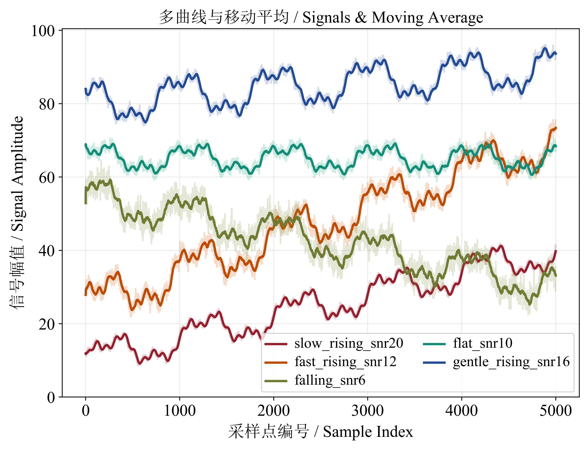

# csvPLOT

[简体中文](README.md) | **English**

Multiple curves, trailing moving averages, and journal figure layouts. [Series home](../README.en.md) · [Experimental CSV](examples/experiment_curves.csv)

```powershell
# Launch from the repository root.
python csvPLOT/csvPLOT.py
```

You can also run `python csvPLOT.py` from this directory. Follow the [main README](../README.en.md) to install dependencies, and retain the sibling `common/` directory.

## Compact figures and editable projects

These figures use **2.8 × 2.0 inch axes and 13 pt text**, with a white background, short labels, and few major ticks. Titles are left to the manuscript caption; outer margins automatically fit labels and legends. PNG exports are **600 DPI**, while PDF/SVG retain vectors. Matplotlib's bundled DejaVu Serif makes the compact examples reproducible across machines. For mixed Chinese/English text, select TimesSimSun in the project.

### Overview of five curves


[PNG](examples/exports/curves.png) · [PDF](examples/exports/curves.pdf) · [SVG](examples/exports/curves.svg) · [Open curves.cplot](examples/projects/curves.cplot)

Each curve contains 5000 points and uses a smoothing window of 25. Pale lines show raw observations; darker lines show moving averages. Duplicate raw-data legend entries are hidden, and the three-column legend sits above the axes.

### Detailed view and smoothing comparison

| Detail, W=25 | The same data with W=25 / 100 / 300 |
| --- | --- |
|  |  |
| [PNG](examples/exports/detail.png) · [PDF](examples/exports/detail.pdf) · [SVG](examples/exports/detail.svg) · [detail.cplot](examples/projects/detail.cplot) | [PNG](examples/exports/smoothing.png) · [PDF](examples/exports/smoothing.pdf) · [SVG](examples/exports/smoothing.svg) · [smoothing.cplot](examples/projects/smoothing.cplot) |

The detailed view displays rows 1000–1800, while its project retains all 5000 points. The comparison uses `falling_snr6`; W25, W100, and W300 denote window lengths in samples. Pale raw lines overlap. Larger windows remove more detail and introduce more lag. The comparison project stores three separately calculated moving averages. **Re-smooth All Curves** replaces them with a common window taken from the input field.

### Additional hand-tuned example



[600 DPI PNG](examples/exports/user-style.png) · [PDF](examples/exports/user-style.pdf) · [SVG](examples/exports/user-style.svg) · [user-style.cplot](examples/projects/user-style.cplot)

Based on a snapshot of a manually styled `test.cplot`, this example retains red, orange, olive, teal, and blue curves; **TimesSimSun 16 pt; 7 × 5 inch axes; a 25-point moving average; a two-column best-position legend; and grid lines**. Raw-line alpha is approximately 0.214 and smoothed-line width is approximately 2.24.

It adds bilingual text: the title is “多曲线与移动平均 / Signals & Moving Average”, the X label is “采样点编号 / Sample Index”, and the Y label is “信号幅值 / Signal Amplitude”. TimesSimSun combines SimSun Chinese glyphs with Times New Roman English glyphs, and the margins accommodate the longer text. The original `test.cplot` was not modified.

This is a larger single-figure styling reference. For multi-panel journal layouts, check font sizes at the final publication width. See the [font instructions](../common/fonts/README.md) for local TimesSimSun loading. The three compact examples are regenerated by the gallery script; this hand-tuned snapshot is maintained separately.

## Continue editing from a project

1. Click **Open Project** and select a `.cplot` in this tool's `examples/projects/` directory.
2. Use **Figure & Axes** to edit axes dimensions, fonts, labels, and limits, or use advanced settings to change colors and lines.
3. Use toolbar **Save** to export an image and **Save Project** to save an editable project.

The complete compact figures are approximately 3.6–4.0 inches wide, depending on font metrics. Check text at the final manuscript size: reducing the entire figure also reduces its text. Exact compact-example dimensions are in the [gallery manifest](../examples/gallery_manifest.json).

## Actual windows and controls


The left panel contains CSV import, project save/open, X/Y selection, colors, smoothing, and Hold. The two lower buttons open figure/axes settings and curve/style settings. The toolbar supports pan, zoom, and export. The screenshot shows the downloadable compact project.


## csvPLOT features

### Data and overlays

| Control | Behavior |
| --- | --- |
| **Load CSV** | Read comma-separated data with a header; try UTF-8 BOM, UTF-8, GB18030, GBK, and Latin-1 encodings |
| **X Column / Y Column** | Select columns; nonnumeric, missing, and infinite Y values are excluded |
| **Curve Color** | Set the color for the next curve |
| **Plot / Add** | Plot the selected columns; X may contain numbers, parseable dates, or text, and is sorted before plotting |
| **Hold** | Retain existing curves when adding data from the same or another CSV |
| **Clear** | Clear curves and the title |

Default labels follow `Y-column (CSV-filename)` and can be edited in advanced settings. Add one Y column at a time.

### Smoothing and line styles

Smoothing is a **trailing moving average**: each point uses itself and at most the preceding `W-1` samples. At the beginning, it uses the available samples. The window is measured in data points and **defaults to 25** in a new session. Opening a project restores its saved window; older projects without that setting use 25.

| Control | Behavior |
| --- | --- |
| **Smoothing Window**, blank or `1` | Disable the smoothed line |
| **Smoothing Window > 1** | Show raw and smoothed lines; the window must be a positive integer |
| **Re-smooth All Curves** | Recalculate every existing curve using the current window, including hidden curves |
| **Original Line Alpha** | Raw-line opacity, `0–1`; default `0.3` |
| **Smooth Darken Factor** | Smoothed-line brightness relative to the selected color, `0.3–1`; smaller values are darker |
| **Smooth Line Width** | Smoothed-line width, `0.5–5` |

The last three controls are under **Advanced Settings → Curve Style**. Click **Apply** after editing. Re-smoothing preserves raw data and curve visibility.

### Curve list and legend

**Advanced Settings → Curves on Plot** supports individual visibility, labels, color swatches, **↑ / ↓** reordering, and **Delete**. Visibility affects both raw and smoothed lines; legend order follows the curve list.

**Figure & Axes → Legend** provides these settings; advanced settings also retain legend controls:

| Control | Behavior |
| --- | --- |
| **Columns** | Number of legend columns |
| **Location** | Automatic `best` or a specified position inside the axes |
| **outside upper / lower / right** | Place the legend outside labels/titles and expand the corresponding margins |
| **Hide all legends** | Hide the entire legend |
| **Hide original data legends** | Hide raw-line entries while retaining smoothed-line entries |

Raw and smoothed lines can both produce entries with the same label. **Hide original data legends** removes this duplication without hiding the raw lines.

## Figure, axes, fonts, and toolbar

The main sidebar has no scrollbar. The initial application window is `1280×820` and can be resized. **Figure & Axes...** opens a tabbed settings dialog. The advanced data list can scroll when many items are present.

### Figure & Axes

| Control | Behavior |
| --- | --- |
| **Axes Width / Axes Height (inches)** | Interior plotting dimensions; default `9×5.5`, positive values only; exclude ticks, labels, title, and legend |
| **Font / Font Size** | Font family and positive point size for titles, axis labels, and tick labels |
| **X Axis: min / step / max** | csvPLOT X limits and major-tick spacing |
| **Y Axis: min / step / max** | Numeric-axis limits and major-tick spacing |
| **Hide last X / Y tick** | Hide the last major-tick label without removing data; csvFIG offers this for its numeric axis |
| **Apply / OK** | Apply the staged figure, font, axes, and legend settings |

Either limit can be specified independently. Blank limits use automatic scaling; a fixed tick step must be positive. In csvFIG's **Box (H)** mode, controls named **Y Axis** apply to the horizontal numeric axis.

The **Axes & Labels** tab edits **Plot Title**, **X-Axis Label**, **Y-Axis Label**, and X/Y grids. Overlapping horizontal tick labels automatically rotate 45° and return to horizontal when space permits.

TimesSimSun is preferred when available for mixed Chinese/English text. Put font files you are entitled to use in `../common/fonts/` and restart; no system-wide installation is needed. Without it, the application uses Matplotlib's bundled font. You may select an installed Chinese font or type a font family name in the field.

Font source and information: [Zhoushijiehqu/Academic-Font-TimesSimSun](https://github.com/Zhoushijiehqu/Academic-Font-TimesSimSun). The [article](https://mp.weixin.qq.com/s/Z--wuiasKW90wUn2dsC5kw) from **A Kun's Research Notes (阿昆的科研日常)** is retained as an introduction, not an authorship credit. The font repository states personal academic research and non-commercial use only. The font is not covered by this project's MIT license, and its binaries are not bundled here. See the [font source/loading notes](../common/fonts/README.md).

The axes area is the data rectangle inside the axis frame. The application measures tick labels, axis labels, titles, and legends and adds outer margins while preserving the requested axes size. Larger text or smaller axes can increase total figure size; shorter labels or smaller text release excess margins. Long tick labels rotate automatically when needed.

For example, `Axes Width=4` and `Axes Height=3` produce a **4×3 inch data rectangle**, with a larger complete image whose size depends on the surrounding text. Outside legends sit beyond the axis labels and title. Very dense labels may still overlap each other; widen the axes, shorten the labels, or reduce the font size.

Only the current figure remains after resizing, with clean gray space around it. Oversized figures are scaled down for preview; exports retain the requested axes dimensions and original DPI.

### Toolbar

| Tool | Behavior |
| --- | --- |
| **Home** | Return to the initial view |
| **Back / Forward** | Navigate view history |
| **Pan** | Drag to pan |
| **Zoom** | Select a rectangle to zoom |
| **Subplots** | Open the same Figure & Axes dialog for dimensions, text, and legends |
| **Save** | Export the current figure |

Pan and zoom do not modify CSV data. Margins are recalculated after navigation or settings changes; exports use the current layout.

## Palette and custom colors

Both tools share these 13 colors. Main-panel colors apply to the next item; advanced color swatches edit existing items.

| Name | Value | Name | Value |
| --- | --- | --- | --- |
| Deep Red | `#A6232F` | Red | `#C0392B` |
| Burnt Orange | `#D35400` | Orange | `#CA6F1E` |
| Amber | `#B7950B` | Olive | `#7D8C3A` |
| Forest Green | `#229954` | Teal | `#16A085` |
| Ocean Blue | `#2E86C1` | Royal Blue | `#2855A6` |
| Indigo | `#4A235A` | Purple | `#7D3C98` |
| Plum | `#9B1B6B` | | |

Color dialogs provide presets, a value field, **Picker…** for the system color picker, and a preview. Use `#RRGGBB` for consistent Tkinter swatches and plotted colors. Alpha ranges from `0` (transparent) to `1` (opaque).

## Image export and project persistence

The generated gallery PNGs are exported at 600 DPI by `../examples/render_gallery.py`, alongside PDF and SVG. The 100 DPI mentioned below is the GUI toolbar's default raster-export DPI. The supplied PDF/SVG files can be used directly in journal layouts. The additional hand-tuned example also has 600 DPI and vector exports.

### Image formats

Click toolbar **Save**. Available formats depend on the environment:

| Type | Formats | Typical use |
| --- | --- | --- |
| Raster | PNG, JPEG/JPG, TIFF/TIF, WebP | Documents, websites, image viewers |
| Vector | PDF, SVG/SVGZ | Papers and subsequent layout work |
| PostScript | EPS, PS | Workflows requiring these formats |

There is no separate export-DPI field. Default raster export uses the initial 100 DPI; pixel dimensions depend on axes size plus measured margins. Preview scaling does not reduce export dimensions. JPEG has no transparent background, and EPS/PS do not fully support transparency. Use PNG, PDF, or SVG when transparency matters. The toolbar may also offer PGF or RAW/RGBA; PGF usually requires a local TeX installation.

### Editable projects

**Save Project** saves embedded data and supported settings; **Open Project** reloads them.

| Content | `.cplot` | `.cfig` |
| --- | --- | --- |
| Data | Raw curves and stored moving averages | Raw observations for every group |
| Appearance | Labels, colors, visibility, order, opacity, smoothed-line styles | Labels, colors, visibility, order, opacity, width, plot type |
| Settings | Titles, axis labels/limits/steps, fonts, grids, legend layout | Titles, axis labels, numeric-axis settings, fonts, grids, statistical elements |
| Further editing | Recalculate curves with another smoothing window | Recompute statistics and switch plot types |

Projects use JSON and contain the plotted data, so the original CSV path is not required. Temporary toolbar navigation history is not persisted; enter limits in **Figure & Axes** when they must be saved. Exported images cannot be reopened as editable projects. Use lowercase `.cplot` and `.cfig` extensions.

## Five experimental curves

Load [experiment_curves.csv](examples/experiment_curves.csv) and select `row` as X. The first column contains row indices **1–5000**; each remaining column combines a linear component, three harmonics, and noise.

| Y column | Trend | Target SNR | Suggested color |
| --- | --- | --- | --- |
| `slow_rising_snr20` | Intercept 10, slowly rising | 20 dB | Royal Blue `#2855A6` |
| `fast_rising_snr12` | Intercept 25, faster rise | 12 dB | Deep Red `#A6232F` |
| `falling_snr6` | Intercept 55, falling | 6 dB | Forest Green `#229954` |
| `flat_snr10` | Intercept 65, zero slope | 10 dB | Purple `#7D3C98` |
| `gentle_rising_snr16` | Intercept 80, gentle rise | 16 dB | Burnt Orange `#D35400` |

1. Select the first Y column, set **Smoothing Window=25**, choose a color, and click **Plot / Add**.
2. Enable **Hold: keep existing curves** and add the remaining columns with different colors.
3. Edit labels, raw-line opacity, and the legend in advanced settings. **Hide original data legends** retains only smoothed-line entries while raw lines remain visible.
4. Try windows **25, 100, and 300**, clicking **Re-smooth All Curves** after each change. Larger windows suppress noise and short-period oscillations but introduce more lag.
5. In **Figure & Axes → Axes & Labels**, try X limits **1–5000** and Y limits **0–100**, then X limits **1000–2000**, and click **Apply**.
6. With Hold enabled, add the same column repeatedly using different windows/colors to compare smoothing. Set final labels after all curves have been added.

### Signal model and SNR

Let `t = row - 1`:

```text
y(t) = b + m*t + h(t) + noise(t)
h(t) = sum(A_k * sin(2*pi*k*t/1000 + k*phase + offset_k))
k = [1, 3, 10]
offset = [0, 0.4, 0.8] rad
```

Harmonic periods are **1000, approximately 333.3, and 100 samples**. The random seed is **20261023**. Gaussian noise is centered and normalized to the specified finite-sample power ratio.

| Column | Intercept b | Slope m | Harmonic amplitudes | Phase, rad | SNR, dB |
| --- | --- | --- | --- | --- | --- |
| `slow_rising_snr20` | 10 | 0.006 | 4 / 1.8 / 0.9 | 0.0 | 20 |
| `fast_rising_snr12` | 25 | 0.009 | 5 / 2.4 / 1.2 | 0.5 | 12 |
| `falling_snr6` | 55 | -0.005 | 4.5 / 1.8 / 1.0 | 1.0 | 6 |
| `flat_snr10` | 65 | 0 | 3 / 1.5 / 0.8 | 0.8 | 10 |
| `gentle_rising_snr16` | 80 | 0.002 | 5 / 2.0 / 1.0 | 1.5 | 16 |

SNR is `10*log10(mean(h²)/mean(noise²))`. **Intercepts and linear trends are excluded from signal power**, so different intercepts do not inflate nominal SNR. CSV values use six decimal places. Measured SNR after rounding, parameters, and summary statistics are stored in the metadata JSON.

## Reproduction and compatibility

From the repository root, run `python examples/render_gallery.py` to regenerate both tools' compact projects and PNG/PDF/SVG through the actual plotting, save, and reopen workflow. A Tkinter desktop environment is required. Other project filenames, including the hand-tuned example, are not overwritten.

`python examples/generate_examples.py` rebuilds the synthetic CSVs. Seeds and summaries are in the [metadata](../examples/dataset_metadata.json). The data demonstrate features and do not represent real experiments.

Projects embed raw data and do not require absolute CSV paths. Legacy whole-figure dimensions are converted to axes dimensions using the former layout proportions. New projects record `size_mode: axes`. Older `.cfig` files containing only summary statistics require the original raw CSV to be reimported.

[MIT license](../LICENSE) · [Back to csvGUI](../README.en.md)
