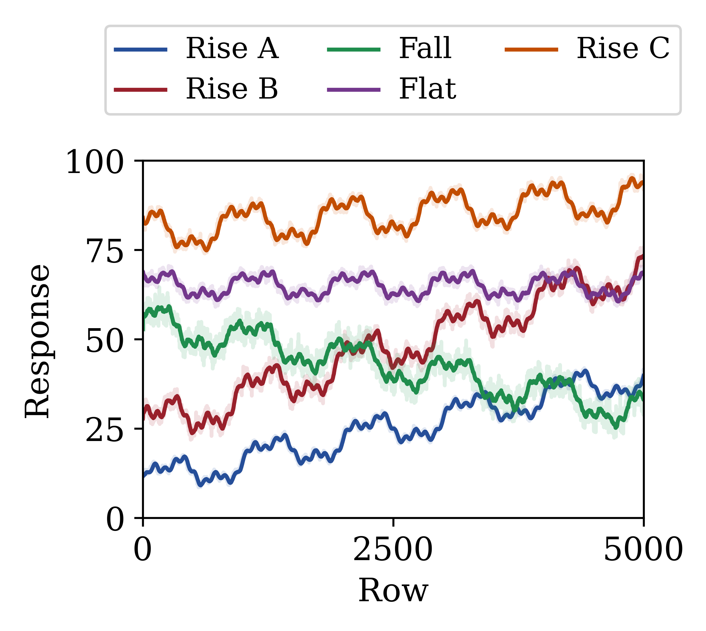
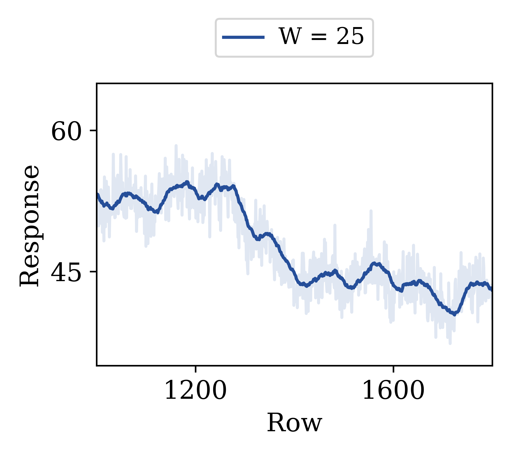
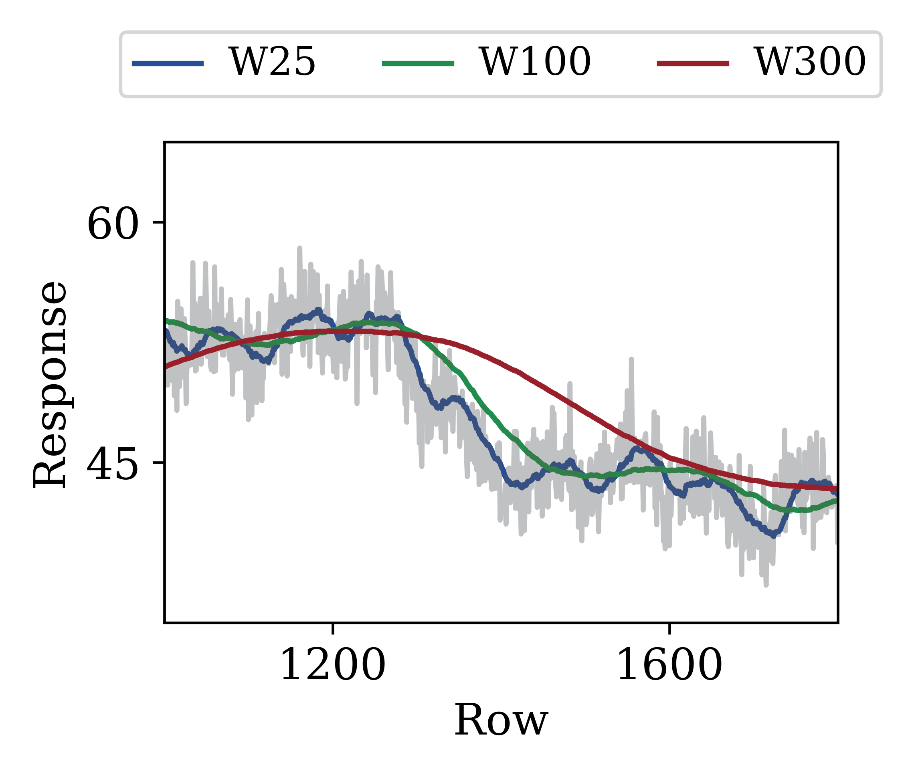
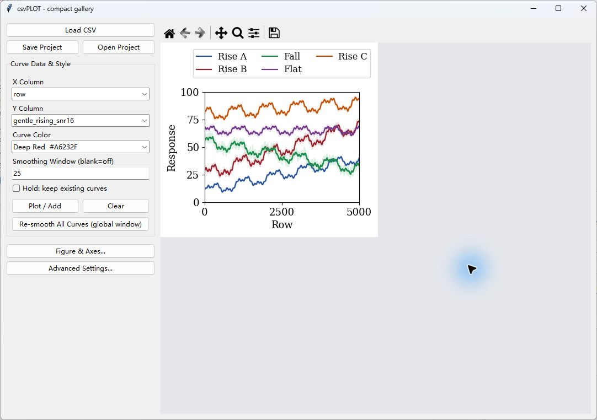
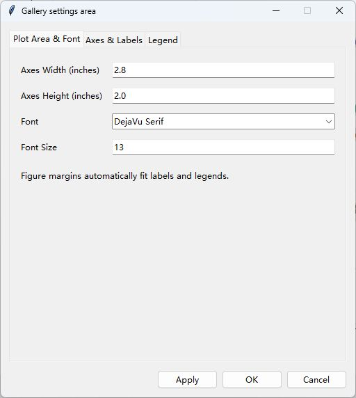
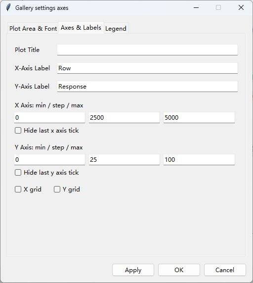
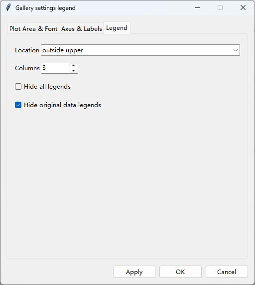

# csvPLOT

多曲线叠加、后向移动平均平滑与期刊插图排版。[系列首页](../README.md) · [实验 CSV](examples/experiment_curves.csv)

```powershell
# 从仓库根目录启动
python csvPLOT/csvPLOT.py
```

也可以在本目录执行 `python csvPLOT.py`。首次使用请按[主 README](../README.md)安装依赖，并保留同级的 `common/` 目录。

## 紧凑插图与可编辑项目

这些图采用 **2.8 × 2.0 英寸坐标区、13 pt 字体**，白底、短标签和少量主刻度。标题留给论文图注，画布自动包住轴标签与图例。PNG 为 **600 DPI**，PDF/SVG 保留矢量；字体选用 Matplotlib 自带的 DejaVu Serif，方便跨机器复现。中英文混排可在项目中改为 TimesSimSun。

### 多曲线全局视图



[PNG](examples/exports/curves.png) · [PDF](examples/exports/curves.pdf) · [SVG](examples/exports/curves.svg) · [打开 curves.cplot](examples/projects/curves.cplot)

全部五条曲线、每条 5000 点，平滑窗口 25。浅色为原始数据，深色为平滑线；原始数据对应的重复图例隐藏，三列图例放在坐标区上方。

### 局部细节与窗口比较

| 局部细节，W=25 | 同一数据的 W=25 / 100 / 300 |
| --- | --- |
|  |  |
| [PNG](examples/exports/detail.png) · [PDF](examples/exports/detail.pdf) · [SVG](examples/exports/detail.svg) · [detail.cplot](examples/projects/detail.cplot) | [PNG](examples/exports/smoothing.png) · [PDF](examples/exports/smoothing.pdf) · [SVG](examples/exports/smoothing.svg) · [smoothing.cplot](examples/projects/smoothing.cplot) |

局部视图显示行号 1000–1800，项目中仍保留完整的 5000 点。窗口比较使用 `falling_snr6`，图例 W25、W100、W300 表示点数窗口，浅色原始线会叠加；更大的窗口会平滑更多细节并带来滞后。窗口比较项目保存了三条各自计算的平滑线；点击 **Re-smooth All Curves** 会将它们统一为输入框中的窗口。

## 直接从项目继续编辑

1. 点击 **Open Project**，选择本目录 `examples/projects/` 中的任一 `.cplot`。
2. 在 **Figure & Axes** 修改坐标区大小、字号、标签和范围，或在高级设置中更改颜色与线条。
3. 点击工具栏 **Save** 导出图片，点击 **Save Project** 另存项目。

各图完整画布约宽 3.6–4.0 英寸，随字体度量略有变化。放入论文后按实际成稿宽度检查字号；若继续缩小整张图，字体也会随之缩小。完整尺寸记录在[图集清单](../examples/gallery_manifest.json)。

## 实际窗口与控件



左侧为 CSV 导入、项目保存/打开、X/Y 选列、颜色、平滑窗口和 Hold；下方两个按钮分别打开坐标与画布设置、曲线及样式设置。右侧工具栏支持平移、缩放和导出。截图中的图形就是上方可下载项目的实际显示效果。







## csvPLOT 功能

### 数据与叠加

| 控件 | 功能 |
| --- | --- |
| **Load CSV** | 读取带表头的逗号分隔 CSV，自动尝试 UTF-8 BOM、UTF-8、GB18030、GBK、Latin-1 编码 |
| **X Column / Y Column** | 选择坐标列。Y 转换为数值，非数值、缺失值及无穷值不参与绘图 |
| **Curve Color** | 选择下一次添加曲线的颜色 |
| **Plot / Add** | 绘制选定列。X 支持数字、可解析的日期或文本，并按 X 排序 |
| **Hold** | 保留已有曲线，可从同一 CSV 或不同 CSV 继续添加 |
| **Clear** | 清空当前曲线和标题 |

默认标签为 `Y列名 (CSV文件名)`，可在高级设置中修改。当前界面每次添加一条 Y 曲线。

### 平滑与线条样式

平滑为**后向移动平均**：每个点只使用当前点及之前最多 `W-1` 个点，开头不足 `W` 个点时使用已有数据。窗口按数据点数计量，**新建窗口默认值为 25**。打开项目时恢复项目中保存的平滑窗口；旧项目未记录时使用 25。

| 控件 | 功能 |
| --- | --- |
| **Smoothing Window** 留空或为 `1` | 关闭平滑线 |
| **Smoothing Window > 1** | 同时显示原始线和平滑线，窗口必须为正整数 |
| **Re-smooth All Curves** | 用当前窗口统一重算已有曲线，包括暂时隐藏的曲线 |
| **Original Line Alpha** | 原始线透明度 `0–1`，默认 `0.3` |
| **Smooth Darken Factor** | 平滑线相对于所选颜色的明暗系数 `0.3–1`，越小越深 |
| **Smooth Line Width** | 平滑线宽 `0.5–5` |

后三项位于 **Advanced Settings → Curve Style**，更改后点击 **Apply**。重新平滑保留原始数据及曲线显隐状态。

### 曲线列表与图例

**Advanced Settings → Curves on Plot** 支持：逐条显隐、标签修改、点击颜色块重新选色、**↑ / ↓** 排序，以及 **Delete** 删除单条曲线。显隐会同时影响该数据的原始线和平滑线，图例按曲线列表顺序排列。

**Figure & Axes → Legend** 提供以下设置，高级设置中也保留图例调整入口：

| 控件 | 功能 |
| --- | --- |
| **Columns** | 图例列数 |
| **Location** | 自动位置 `best`，或图内上、下、左、右、中心等位置 |
| **outside upper / lower / right** | 将图例放在坐标区外侧，避开坐标标签和标题，并自动扩展画布边距 |
| **Hide all legends** | 隐藏整个图例 |
| **Hide original data legends** | 隐藏原始线对应的图例项，保留平滑线图例项 |

原始线和平滑线默认可以各自生成图例项，因此可能出现同名项。使用 **Hide original data legends** 可以精简图例。

## 画布、坐标区、字体与工具栏

主窗口侧栏没有滚动条，右侧为 Matplotlib 画布。窗口可缩放，起始窗口为 `1280×820`。点击 **Figure & Axes...** 在弹窗中调整图形设置。高级设置中的数据列表可滚动，以支持较多曲线或分组。

### Figure & Axes

| 控件 | 功能 |
| --- | --- |
| **Axes Width / Axes Height (inches)** | 坐标区内部宽高，单位英寸，默认 `9×5.5`，必须为正数；不包含刻度、标签、标题和图例 |
| **Font / Font Size** | 标题、坐标标签和刻度字体与字号，字号必须为正数 |
| **X Axis: min—step—max** | csvPLOT 的 X 范围与固定主刻度间隔 |
| **Y Axis: min—step—max** | 两个工具的数值轴范围与固定主刻度间隔 |
| **Hide last X / Y tick** | 隐藏最后一个主刻度标签，不删除数据；csvFIG 仅提供数值轴选项 |
| **Apply / OK** | 应用弹窗内的画布、字体、坐标与图例设置 |

范围上下限可单独指定，留空的范围自动缩放。固定刻度间隔应为正数。csvFIG 在 `Box (H)` 模式下，面板中名为 **Y Axis** 的范围、步长和末刻度选项实际应用到横向数值轴。

**Axes & Labels** 页签可编辑 **Plot Title、X-Axis Label、Y-Axis Label** 及 X/Y 网格。较长的横轴刻度标签重叠时自动旋转 45°，恢复空间后重新水平排列。

程序优先使用已找到的 **TimesSimSun**，适合宋体中文和 Times New Roman 英文混排。将有权使用的字体文件放入 `../common/fonts/`，重启后自动注册，不需要在系统中安装。没有该字体时使用 Matplotlib 自带字体，也可以选择本机已安装的中文字体。字体下拉框还支持手动输入名称。

TimesSimSun 的用户提供来源为公众号 **阿昆的科研日常**，[原文链接](https://mp.weixin.qq.com/s/Z--wuiasKW90wUn2dsC5kw)。本地副本已接入字体；公开仓库不包含字体二进制，获取来源不等于原字体的再分发许可，详见 [fonts/README.md](../common/fonts/README.md)。

坐标区是坐标轴边框以内的数据绘制区域。程序按字体和字号测量刻度、轴标签、标题及图例，在四周自动增加画布空间，保持指定的坐标区宽高；长横轴刻度标签重叠时自动倾斜。缩小坐标区或增大字号时，文字仍会被纳入画布；减小字号或缩短文字后，多余边距也会收回。

例如设置 `Axes Width=4`、`Axes Height=3`，导出图中的坐标区为 `4×3` 英寸，完整图片会更大，具体大小随文字与图例变化。外置图例会排列在坐标标签和标题之外。很密集的标签仍可通过加宽坐标区、缩短标签或减小字号来改善相互遮挡。

调整尺寸后只保留当前图像，空余区域使用灰色背景。完整画布大于显示区域时按比例缩小预览，导出仍保留指定的坐标区英寸尺寸和原始 DPI。

### 工具栏

| 工具 | 功能 |
| --- | --- |
| **Home** | 返回初始视图 |
| **Back / Forward** | 切换视图历史 |
| **Pan** | 拖动平移 |
| **Zoom** | 框选放大局部区域 |
| **Subplots** | 打开同一个 Figure & Axes 弹窗，设置坐标区大小、文字与图例 |
| **Save** | 导出当前图形 |

交互缩放不修改 CSV 数据。平移、缩放或修改设置后，程序会自动重算外围边距，导出时也会使用当前布局。

## 色卡与自定义颜色

两个工具共用以下 13 色。主面板为下一条曲线或下一组数据选色，高级设置的颜色块修改已经绘制的数据。

| 名称 | 颜色值 | 名称 | 颜色值 |
| --- | --- | --- | --- |
| Deep Red | `#A6232F` | Red | `#C0392B` |
| Burnt Orange | `#D35400` | Orange | `#CA6F1E` |
| Amber | `#B7950B` | Olive | `#7D8C3A` |
| Forest Green | `#229954` | Teal | `#16A085` |
| Ocean Blue | `#2E86C1` | Royal Blue | `#2855A6` |
| Indigo | `#4A235A` | Purple | `#7D3C98` |
| Plum | `#9B1B6B` | | |

取色窗口支持预设颜色、颜色值输入、**Picker…** 系统取色器及颜色预览。为保证 Tkinter 色块与绘图一致，自定义颜色建议使用 `#RRGGBB`。透明度通过 Alpha 控件设置，`0` 为透明，`1` 为不透明。

## 图片导出与项目保存

本页展示的示例由 `../examples/render_gallery.py` 以 600 DPI 导出 PNG，同时输出 PDF 和 SVG。以下说明中的 100 DPI 指 GUI 工具栏默认的位图导出；期刊排版可直接使用已提供的 PDF/SVG。

### 图片格式

点击工具栏 **Save**。常用格式如下，具体以当前环境保存对话框为准。

| 类型 | 格式 | 使用场景 |
| --- | --- | --- |
| 位图 | PNG、JPEG/JPG、TIFF/TIF、WebP | 文档插图、网页、常规图像展示 |
| 矢量图 | PDF、SVG/SVGZ | 论文和后续排版，保留文字及线条缩放能力 |
| PostScript | EPS、PS | 需要这些格式的排版流程 |

界面没有单独的导出 DPI 输入框，默认导出按初始 100 DPI 生成，完整图片像素尺寸取决于指定的坐标区大小及自动测得的外围边距，预览缩放不会降低导出尺寸。JPEG 不保留透明背景，EPS/PS 不完整支持透明度。需要透明效果时可使用 PNG、PDF 或 SVG。工具栏还可能提供 PGF、RAW/RGBA 等格式，其中 PGF 通常需要本机 TeX 环境。

### 可编辑项目

**Save Project** 保存数据与程序支持的设置，**Open Project** 重新加载。

| 内容 | `.cplot` | `.cfig` |
| --- | --- | --- |
| 数据 | 原始曲线、已有平滑线 | 各组原始观测 |
| 样式 | 标签、颜色、显隐、顺序、透明度、平滑线样式 | 标签、颜色、显隐、顺序、透明度、宽度、图形类型 |
| 设置 | 标题、轴标签、范围、步长、字体、网格、图例布局 | 标题、轴标签、数值轴设置、字体、网格、统计元素选项 |
| 继续编辑 | 修改平滑窗口后统一重算 | 重新计算统计值并切换图形类型 |

项目文件使用 JSON，包含已绘制的数据，不依赖原 CSV 路径。工具栏的临时缩放历史不会持久化，需保存的范围建议写入 Figure & Axes 弹窗。

导出的图片不能通过 Open Project 恢复为可编辑项目。项目扩展名统一使用小写 `.cplot`、`.cfig`。

### 五条实验曲线

运行 `csvPLOT.py`，点击 **Load CSV** 打开 `csvPLOT/examples/experiment_curves.csv`，X 选择 `row`。首列为 **1 到 5000 的行号**，其余列都同时包含线性项、三个谐波和噪声。

| Y 列 | 趋势 | 目标信噪比 | 建议颜色 |
| --- | --- | --- | --- |
| `slow_rising_snr20` | 截距 10，缓慢上升 | 20 dB | Royal Blue `#2855A6` |
| `fast_rising_snr12` | 截距 25，较快上升 | 12 dB | Deep Red `#A6232F` |
| `falling_snr6` | 截距 55，下降 | 6 dB | Forest Green `#229954` |
| `flat_snr10` | 截距 65，零斜率基线 | 10 dB | Purple `#7D3C98` |
| `gentle_rising_snr16` | 截距 80，轻微上升 | 16 dB | Burnt Orange `#D35400` |

1. 选择第一条 Y 曲线，设置 **Smoothing Window = 25**，选择颜色，点击 **Plot / Add**。
2. 勾选 **Hold: keep existing curves**，逐个添加其余四列，每次换一个颜色。
3. 全部添加后，在 **Advanced Settings** 修改标签、原始线透明度和图例。勾选 **Hide original data legends**，可以只保留平滑线的图例项，原始线仍显示。
4. 分别尝试窗口 **25、100、300**，每次修改后点击 **Re-smooth All Curves**。较大窗口会削弱噪声和短周期振荡，也会产生更明显的滞后。
5. 打开 **Figure & Axes → Axes & Labels**，将 X 范围设为 **1—5000**、Y 范围设为 **0—100**，再尝试 X 范围 **1000—2000**，点击 **Apply** 比较整体与局部。
6. 也可以勾选 Hold，给同一列重复添加不同窗口、不同颜色的版本，在同一图中比较平滑效果。建议曲线添加完成后再统一设置标签。


### 曲线模型与 SNR

设 `t = row - 1`：

```text
y(t) = b + m*t + h(t) + noise(t)
h(t) = Σ A_k * sin(2π*k*t/1000 + k*phase + offset_k)
k = [1, 3, 10]
offset = [0, 0.4, 0.8] rad
```

谐波周期分别为 **1000、约 333.3、100 个采样点**。随机种子为 **20261023**。高斯噪声生成后去均值，并按有限样本功率归一化。

| 列 | 截距 b | 斜率 m | 谐波振幅 | phase，rad | SNR，dB |
| --- | --- | --- | --- | --- | --- |
| `slow_rising_snr20` | 10 | 0.006 | 4 / 1.8 / 0.9 | 0.0 | 20 |
| `fast_rising_snr12` | 25 | 0.009 | 5 / 2.4 / 1.2 | 0.5 | 12 |
| `falling_snr6` | 55 | -0.005 | 4.5 / 1.8 / 1.0 | 1.0 | 6 |
| `flat_snr10` | 65 | 0 | 3 / 1.5 / 0.8 | 0.8 | 10 |
| `gentle_rising_snr16` | 80 | 0.002 | 5 / 2.0 / 1.0 | 1.5 | 16 |

信噪比定义为 `10*log10(mean(h²)/mean(noise²))`，**不把截距或线性趋势计入信号功率**，避免不同截距虚增名义信噪比。数据保留 6 位小数，舍入后实测 SNR、参数和统计摘要保存在元数据 JSON 中。

## 复现与兼容性

从仓库根目录运行 `python examples/render_gallery.py`，会使用真实 GUI 的绘图、保存、重开流程，重新生成两个工具的示例项目和 PNG/PDF/SVG。需要 Tkinter 桌面显示环境；脚本不会覆盖你的其他项目文件。

`python examples/generate_examples.py` 可重建合成 CSV；种子与数值摘要见[元数据](../examples/dataset_metadata.json)。实验数据仅作功能演示，不代表真实实验结果。

项目内含原始数据，不依赖 CSV 的绝对路径。旧项目的整图宽高会按原布局比例换算为坐标区尺寸；新项目以 `size_mode: axes` 标记。仅含汇总统计值的旧 `.cfig` 需要重新导入原始 CSV。

采用 [MIT 许可证](../LICENSE)。[返回 csvGUI 系列首页](../README.md)。
